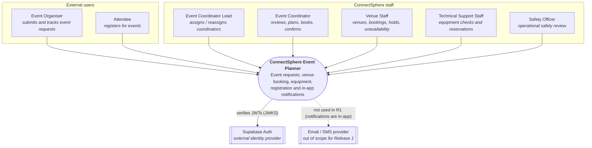
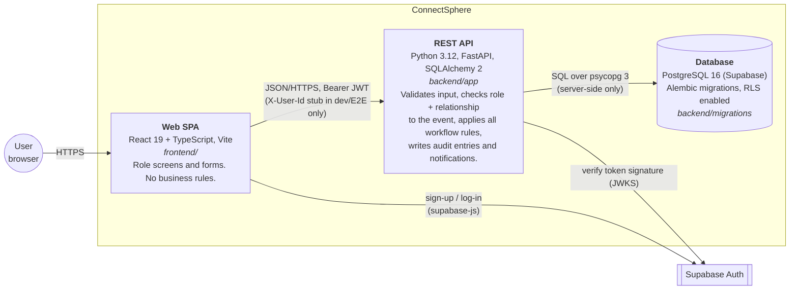
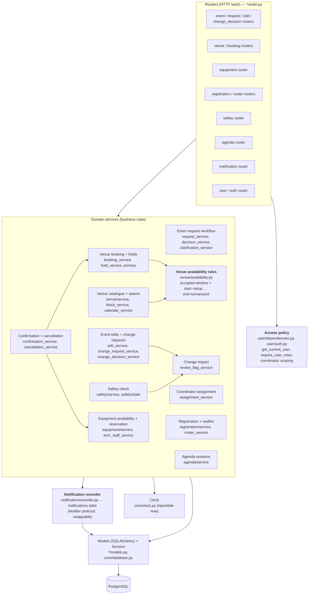
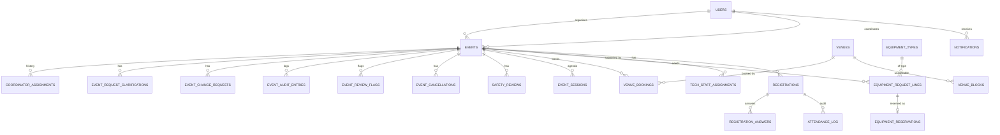
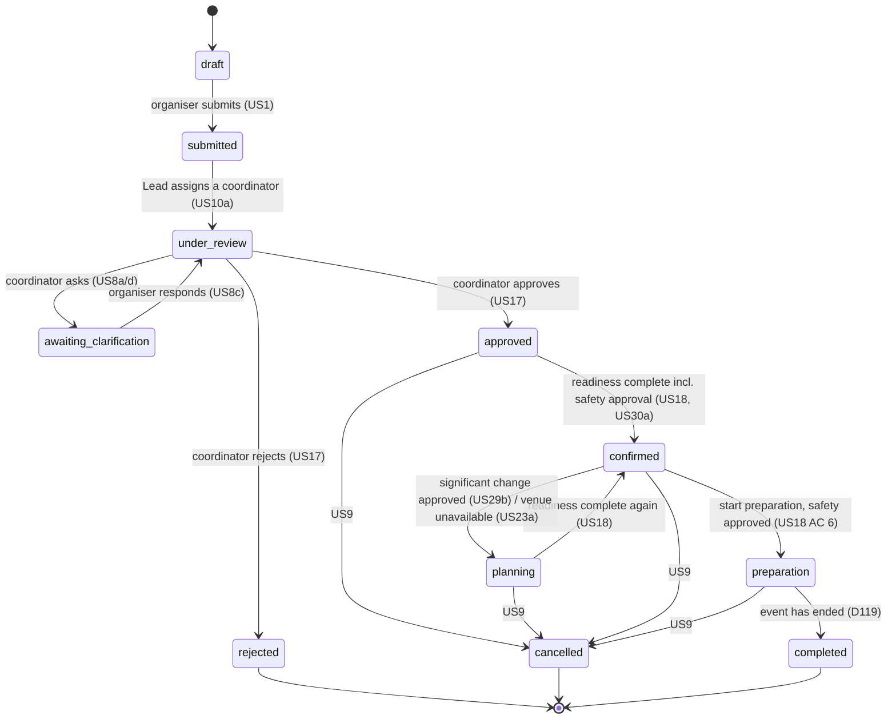

# ConnectSphere — C4 model (as built, Release 1)

This is the C4 model of the system **as it is implemented on `main`**. It supersedes the stack
named in the High Level Design v0.5 (Next.js Server Actions on Vercel): during Sprint 1 the team
switched the scaffold to a **FastAPI backend + React/Vite SPA** (commit `d521b6e`, "Switch scaffold to
FastAPI/Postgres backend and TS frontend"). Supabase stayed as the database and identity provider.
The responsibilities, design rules and Week 7 change traceability in the HLD still hold; only the
technology of the containers changed. See [Design decisions](#design-decisions-and-trade-offs).

Diagrams are Mermaid, so they render directly on GitHub.

## Level 1 — System context

## Level 2 — Containers

| Container | Technology | Responsibility |
| --- | --- | --- |
| Web SPA | React 19, TypeScript, Vite, supabase-js | One screen set per role, chosen from the user's roles. Calls only the REST API (plus Supabase Auth for the session). Holds no business rules. |
| REST API | FastAPI, Pydantic v2, SQLAlchemy 2, PyJWT | Single entry point for every read and change. Every route resolves the caller, checks role **and** relationship to the event, then calls a domain service. |
| Database | PostgreSQL 16 on Supabase (Docker Postgres locally and in CI) | All persistent state. Schema owned by Alembic; RLS is on and the browser never talks to the database directly (SCRUM-118 grants). |
| Supabase Auth | Managed | Sign-up, log-in, sessions; issues the JWT the API verifies. |

## Level 3 — Components of the REST API

### Design rules visible in this view

1. **Every change goes through a router that calls the access policy first.** Coordinators see only
   events assigned to them; the Lead sees all assignments (US16b).
2. **One availability rule.** `venue/availability.py` is the only place that applies setup and
   turnaround time, so search, booking, holds, approval and the calendar always agree (CR-01, US13).
3. **Flag, never silently delete.** When an event edit, a venue unavailability or a safety outcome
   affects existing arrangements, `review_flag_service` / `block_service` flag the bookings and
   reservations for review (CR-02, US12, US23a, US29b).
4. **Services raise `DomainError`; routers never build error responses by hand** (`core/exceptions.py`).
5. **Notifications are written by services through the `Notifier` protocol**, never by the UI.
   Tests inject a recording notifier and assert on the calls.
6. **Time is injected** (`core/clock.py`), so hold expiry and waitlist-offer expiry ("lapse on read")
   are deterministic in tests without a scheduler.
7. **Row locking for races.** Approve, cancel, replacement and primary-venue changes lock rows in a
   fixed order (`SELECT … FOR UPDATE`); race tests prove it (`test_*_race.py`).

## Level 4 — Data model (key tables)

Full column-level definitions: [`claude_instructions.md` §2](../../claude_instructions.md#2-data-model-supabase--postgres).

## Event status lifecycle

> Every transition above is a line in a service under `backend/app/event/` or `backend/app/venue/block_service.py`
> (search for `event.status = EventStatus.`). The Safety Officer's decision is a **gate in the readiness list**,
> not a status of its own: a rejection or "request changes" (US30a/b) keeps the event where it is and blocks
> confirmation until the coordinator revises the arrangement.

## Design decisions and trade-offs

| Decision | Alternatives considered | Why |
| --- | --- | --- |
| FastAPI + React SPA instead of the HLD's Next.js Server Actions | Next.js full-stack on Vercel | The team's strongest language was Python; pytest + a real Postgres gave fast, trustworthy integration tests of business rules; clean HTTP contract between SPA and API made frontend work parallel (MSW mocks the API in Vitest). Cost: two deployables instead of one. |
| Business rules only in the API; RLS as a second line | Rules in Postgres (RLS/policies) or in the UI | Rules are testable in Python, one place to change; RLS still blocks direct table access with the public key (SCRUM-118). |
| A single `availability.py` rule | Each feature computing its own overlaps | CR-01 (buffers) touched search, booking, approval, holds and calendar — one rule meant one change. |
| "Lapse on read" for holds and waitlist offers instead of a scheduler | Cron / background worker | No scheduler is available on the chosen hosting; computing expiry when the record is read is deterministic and testable via the injected clock. Trade-off: no proactive "about to expire" push unless a user opens the app. |
| In-app notifications table behind a `Notifier` protocol | Email/SMS now | Customer confirmed email/SMS is out of scope for R1; the protocol lets a real provider be added without touching services. |
| Flag affected arrangements rather than auto-cancel | Automatic cancellation/rebooking | Customer clarification: changes must not silently remove bookings; a human decides (CR-02, US12, US29b). |
| Pessimistic row locks for approve / cancel / replace | Optimistic versioning | Collisions are rare but costly (double booking); locks in a fixed order are simpler to reason about and are covered by race tests. |
