# US15 — Multi-session event programme (SCRUM-18): test cases

**Story:** As an Event Organizer, I want to build a structured multi-session event agenda with designated session titles, timings, and activity types, so that ConnectSphere staff and registered attendees have a clear breakdown of the event schedule.

**Source of truth:** the acceptance criteria in Jira SCRUM-18 and its subtasks SCRUM-138 to SCRUM-140, which hold these test cases. If they disagree, Jira wins; fix this file.

**Acceptance criteria (short form):**

1. The Organiser adds, edits and deletes agenda items within a draft or active planning request.
2. Each session has a title, start time, end time, speaker or presenter, and session type.
3. A session outside the event's confirmed date and time window can't be saved.
4. Sessions that overlap within the same single-track schedule can't be saved.
5. The schedule is shown in chronological order on the event overview page.

**Delivery:** one PR per subtask, in this order.

| PR | Subtask | Scope | Tests |
| --- | --- | --- | --- |
| 1 | SCRUM-138 | `event_sessions` (one track per event); the seeded Agenda Demo, whose sessions a reseed clears | `backend/tests/agenda/test_event_sessions_schema.py` |
| 2 | SCRUM-139 | `GET` / `POST /api/v1/event-requests/{id}/sessions`, `PATCH` / `DELETE /api/v1/event-sessions/{id}` | backend `pytest`; the routes in US16b's role matrix (TC-US16B-14) |
| 3 | SCRUM-140 | **Agenda** on the request's details in the Organiser's Event requests screen | Vitest; E2E |

## Decisions for this story

Decided by the acting PO, Matthew, on 1 Nov (team channel).

- **D93, who and when (AC 1):** the request's own Organiser, while it's `draft` or `planning`; read-only in every other status, `awaiting_clarification` included, and for anyone else who can read the request.
- **D94, the window (AC 3):** a `planning` event's `[start_at, end_at]`; for a draft, D65's window (one of its preferred dates, between its preferred times). Existing sessions aren't re-checked when the dates change, so the Agenda marks any outside the current window.
- **D95, single track (AC 4):** each event is one track; no two of its sessions overlap. A track per room is a likely follow-up.
- **D96, session fields (AC 2):** the AC's types plus `other`; the speaker is required unless it's a break.
- **D97, where (AC 5):** the request's details in the Organiser's Event requests screen.

## Test cases

| ID | AC | Given | When | Then | Subtask |
| --- | --- | --- | --- | --- | --- |
| TC-US15-01 | — | A database at the previous head | `alembic upgrade head` | `event_sessions` exists with its columns, the `session_type` enum, RLS on and the exclusion constraint; one Alembic head | SCRUM-138 |
| TC-US15-02 | 2 | An event | Sessions are saved with: a blank title; an end not after the start; no speaker on a non-break; an unknown event; then a break with no speaker, and an `other` session with a speaker | Each of the first four is refused on its named CHECK or the foreign key; the break and the `other` session save | SCRUM-138 |
| TC-US15-03 | 4 | An event with a 10:00–11:00 session | Another session is saved on the same event at 10:30–11:30; one at 11:00–12:00; and one at 10:30–11:30 on a different event | The first is refused on the exclusion constraint; back-to-back saves; the other event's saves | SCRUM-138 |
| TC-US15-04 | — | The seed; sessions on Agenda Demo and on another event | The seed runs (twice) | Agenda Demo exists in `planning`, owned by the seeded organiser, with its times; the second run changes nothing; Agenda Demo's sessions are gone and the other event's remain | SCRUM-138 |
| TC-US15-05 | 1, 2, 5 | The owner's draft with preferred dates and times | The owner adds a presentation, a workshop, a panel, a break and an `other` session, then lists them | `201` each; the list is in chronological order with every field | SCRUM-139 |
| TC-US15-06 | 1 | A session | The owner edits its title, speaker and times; then deletes it | `200` with the new values; `204`, then it's gone from the list | SCRUM-139 |
| TC-US15-07 | 3 | A planning event (10:00–17:00), and a draft with two preferred dates, 09:00–12:00 | Sessions starting before, ending after, or on a date that isn't preferred; one exactly at the edges; a draft with no dates; the planning event's start moved past a saved session | Outside the window is `422 INVALID_SESSION` naming `starts_at` / `ends_at`; the edges save; no dates is `422` saying the event's dates are needed first; the moved-past session stays, and the list marks it `outside_window` | SCRUM-139 |
| TC-US15-08 | 4 | A 10:00–11:00 session | Adding, or editing another session to, 10:30–11:30; adding 11:00–12:00; editing the first session within its own times | `409 SESSION_OVERLAP` naming the 10:00 session; back-to-back saves; a session doesn't clash with itself | SCRUM-139 |
| TC-US15-09 | 2 | A blank title, an end before the start, a non-break with no speaker, an unknown type | The owner adds it | `422 INVALID_SESSION`, naming every invalid field at once | SCRUM-139 |
| TC-US15-10 | 1 | A request in `submitted`, `awaiting_clarification`, `approved`, `confirmed` and `preparation` | The owner adds, edits or deletes a session | `409 AGENDA_NOT_EDITABLE` with the status; nothing changes; listing still works | SCRUM-139 |
| TC-US15-11 | — | Another organiser; a Lead; the assigned coordinator; other roles; no identity; an unknown request or session | They list, add, edit or delete | Another organiser `404`; the Lead and the assigned coordinator list a submitted request's agenda but get `403` changing it; other roles `403`; no identity `401`; unknown `404` | SCRUM-139 |
| TC-US15-12 | 4 | Two overlapping sessions for one draft | Both are saved at the same moment | One `201`, the other `409 SESSION_OVERLAP`: a real two-connection race, as TC-US27-11 | SCRUM-139 |
| TC-US15-13 | 1, 2, 3, 5 | The owner's draft with preferred dates | They add a session, fix a field error, edit it and delete another | Errors show on the fields; the agenda is in chronological order after each change | SCRUM-140 |
| TC-US15-14 | 1, 3, 4 | A mocked `SESSION_OVERLAP`; a submitted request; a session outside the current window | The owner saves; opens the submitted one; opens the third | The overlap is shown naming the clashing session; the submitted one's agenda is read-only; the session is marked "Outside the event's times" | SCRUM-140 |
| TC-US15-15 | 1, 2, 5 | Agenda Demo (planning) | The organiser adds a break and a presentation, then edits one, out of time order | The agenda shows them in chronological order. Rerun after a reseed | SCRUM-140 |

## Evidence

SCRUM-139's API, called on a local server (`AUTH_DEV_HEADERS=true`) against a freshly seeded database, as the seeded organiser Olivia Organiser and Lead Lena Lim, at the commit that adds these files. Agenda Demo is `planning`, 09:00 to 17:00 on its day (Singapore time); the submitted request is Olivia's Neighbourhood planning workshop. The sessions added were deleted afterwards, so Agenda Demo is as the seed left it.

### SCRUM-139: the organiser adds a session (TC-US15-05)

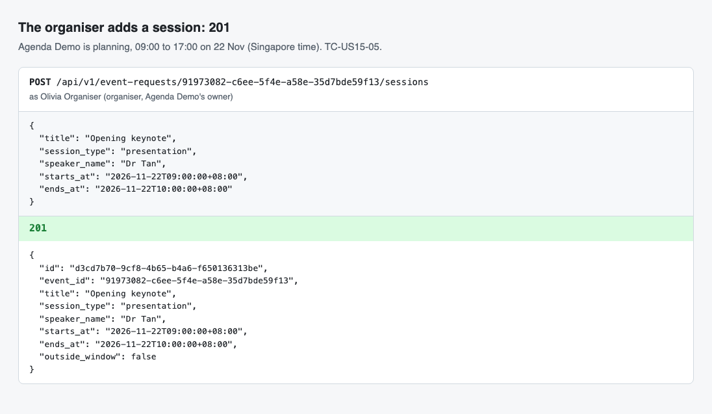

### SCRUM-139: chronological order (TC-US15-05, AC 5)

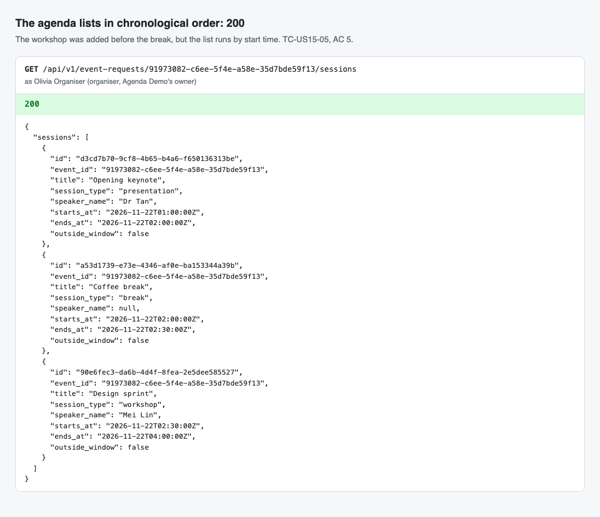

### SCRUM-139: one track (TC-US15-08, AC 4)

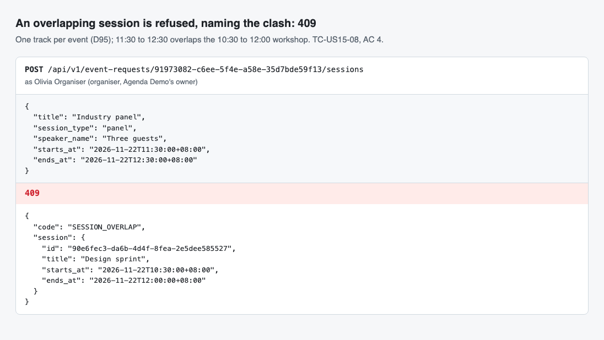

### SCRUM-139: the event's window (TC-US15-07, AC 3)

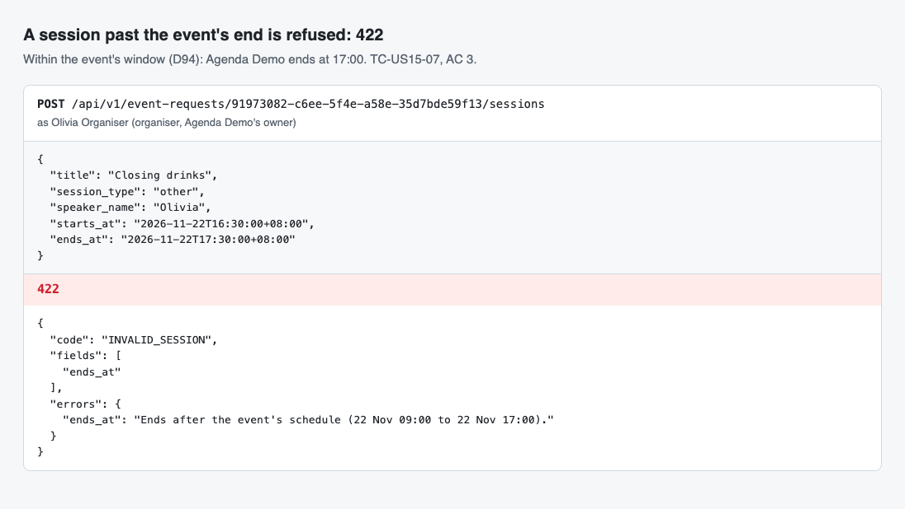

### SCRUM-139: every invalid field at once (TC-US15-09, AC 2)

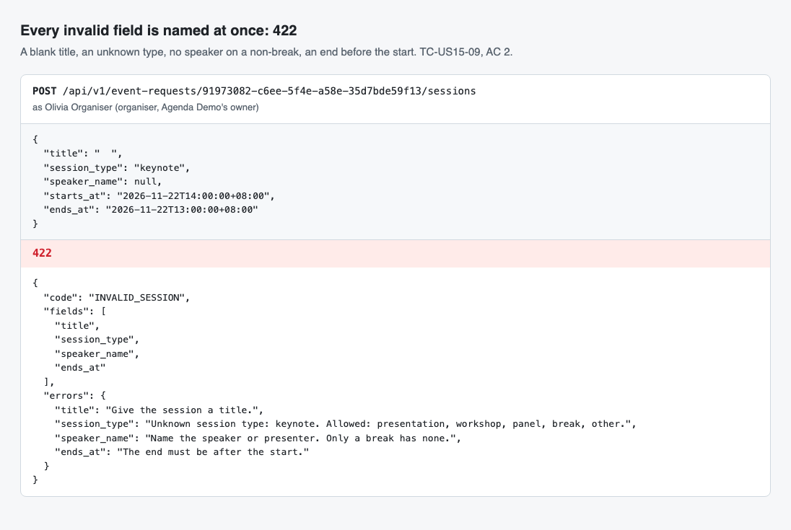

### SCRUM-139: edit and delete (TC-US15-06, AC 1)

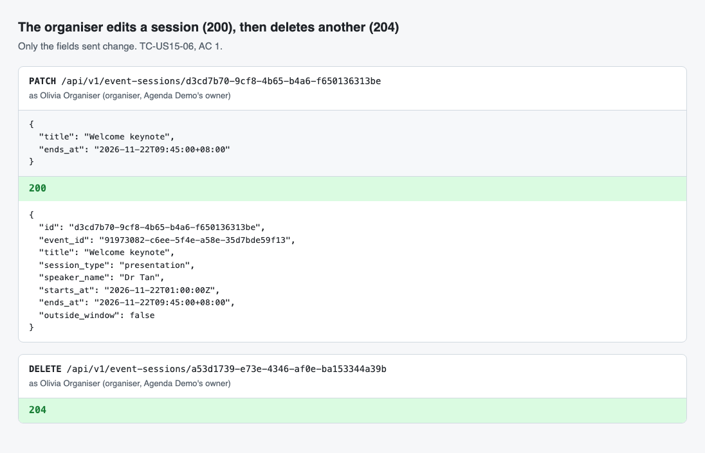

### SCRUM-139: read-only once submitted (TC-US15-10, AC 1)

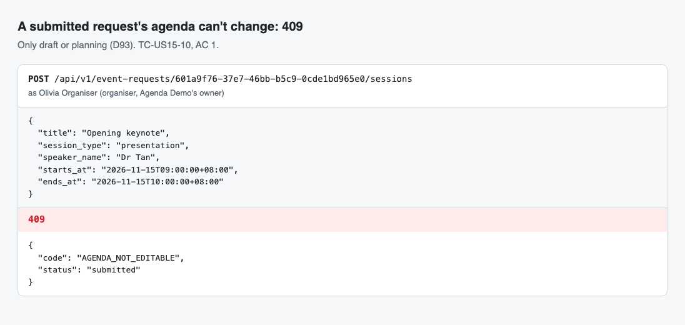

### SCRUM-139: a Lead reads but doesn't change (TC-US15-11)

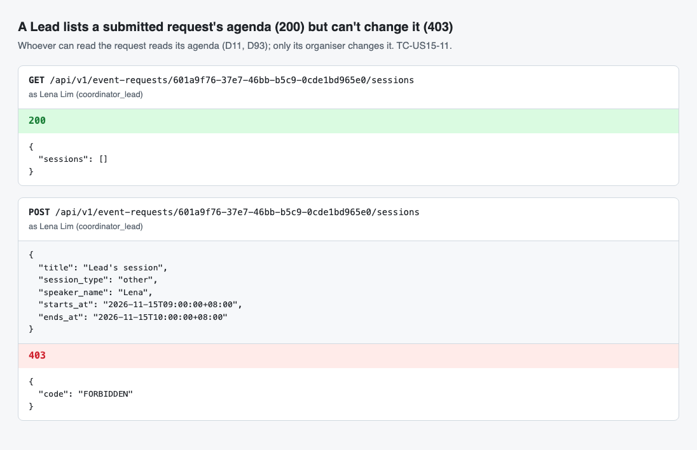

### SCRUM-139: the backend tests

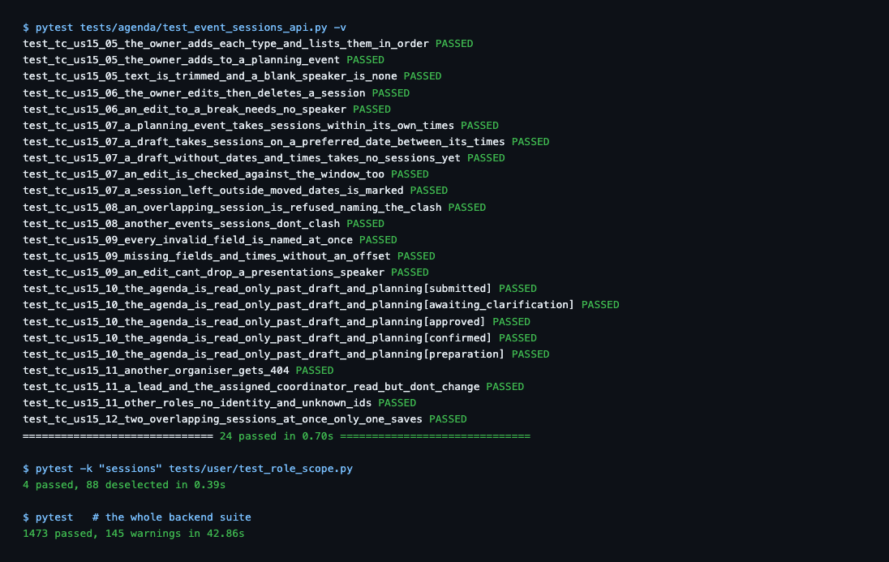

SCRUM-140's screen, on a local server and a freshly seeded database, as the seeded organiser Olivia Organiser. For the outside-the-window shot, Agenda Demo's start was moved 90 minutes later in the local database only, then reseeded.

### SCRUM-140: a field error on its field (TC-US15-13, AC 2)

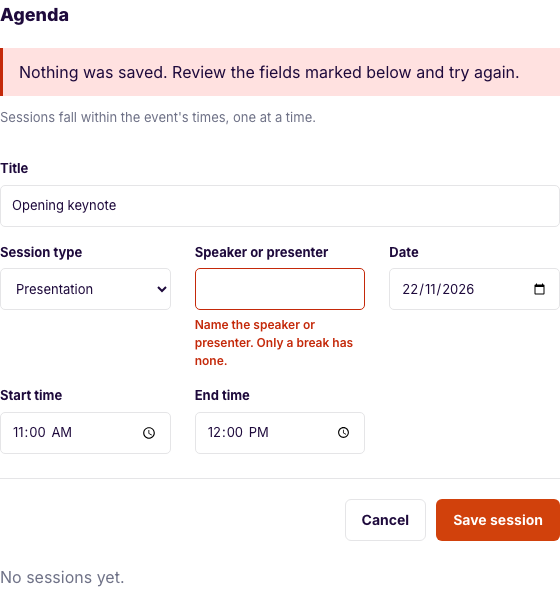

### SCRUM-140: chronological order (TC-US15-13, AC 5)

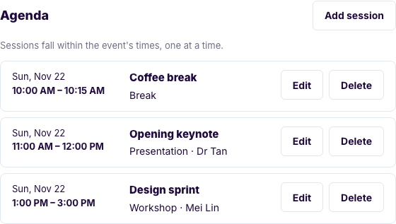

### SCRUM-140: an overlap names the clash (TC-US15-14, AC 4)

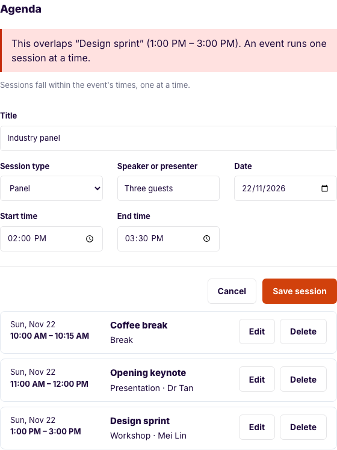

### SCRUM-140: outside the event's times (TC-US15-14, D94)

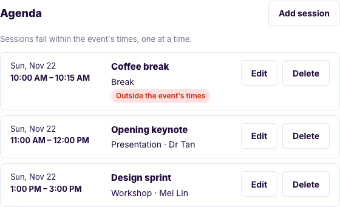

### SCRUM-140: read-only once submitted (TC-US15-14, AC 1)

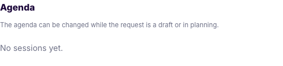

### SCRUM-140: the frontend and E2E tests

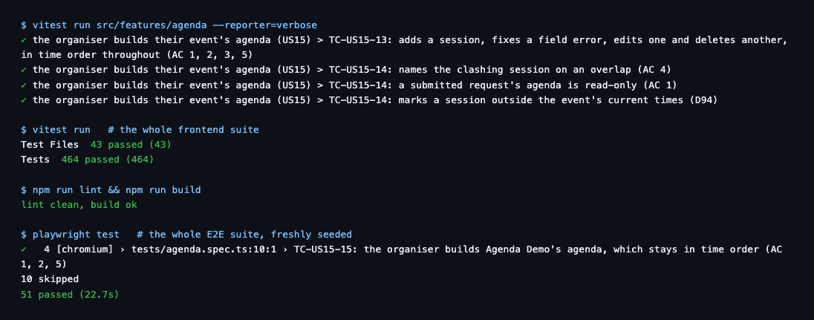

## Run log

| Date | Subtask | What ran | Result |
| --- | --- | --- | --- |
| 1 Nov | SCRUM-138 | `pytest` (local Postgres): `tests/agenda/test_event_sessions_schema.py`, then the full backend suite; `alembic downgrade -1` and `upgrade head`; the seed | Tests written first: they failed on collection (no `app.agenda`). After the change: 12 items for TC-US15-01 to 04 pass. Whole backend suite 1249 passed; the migration round-trips and the seed runs |
| 1 Nov | SCRUM-138 | After merging `main` (#107, #110): the full backend suite; `alembic heads`, `downgrade -1` and `upgrade head`; the seed | The migration now chains after `20261108_1200_us12_event_edits` (US12, #107), one head. Whole backend suite 1291 passed; the migration round-trips and the seed runs, with both planning demo events (US12's Event Planning Demo and Agenda Demo) |
| 1 Nov | SCRUM-138 | After merging `main` again (#109, US18, US29a, US30a): the full backend suite; `alembic heads`, `downgrade -1` and `upgrade head`; the seed | The migration is renamed `20261111_1200_us15_sessions` and chains after `20261110_1200_us30a_safety`, one head; US15's decisions are renumbered D93 to D97, as D87 to D92 are now taken. TC-US29a-18 checked that US30a's migration was the head, so it now checks for one head with US29a's migration in the chain, as the other schema tests do. Whole backend suite 1445 passed; the migration round-trips and the seed runs |
| 1 Nov | SCRUM-139 | `pytest` (local Postgres): `tests/agenda/test_event_sessions_api.py` and `tests/user/test_role_scope.py`, then the full backend suite | Tests written first: the API tests failed on collection (no `app.agenda.service`) and the role matrix on the four new routes. After the change: 24 items for TC-US15-05 to 12 pass, and the four routes in TC-US16B-14. TC-US15-12 fails with the event's `FOR UPDATE` removed (the second save hits `event_sessions_no_overlap` instead of a `409`). Whole backend suite 1473 passed |
| 1 Nov | SCRUM-139 | After merging `main` (#115, US9's cancellation schema): `alembic upgrade head`; the full backend suite | US9 took deviation 63 and #116 (US30b) is on 64, so this PR's is 65; D93 to D97 are unchanged. Whole backend suite 1500 passed |
| 1 Nov | SCRUM-139 | After merging `main` (#116, US30b; then #120, the `safety_reviews` RLS fix): the full backend suite; markdownlint | One head (#120's `20261114_1200_us30a_rls`, as this PR adds no migration); US30b keeps deviation 64 and this PR 65. Whole backend suite 1524 passed. A blank line was missing above Run log (MD022), which CI's markdownlint caught |
| 1 Nov | SCRUM-139 | After merging `main` (#117, US9's cancellation API): the full backend suite; markdownlint | US9's PR 2 took deviation 65, so this PR's is 66; both PRs' routes are in TC-US16B-14's matrix. One head (`20261114_1200_us30a_rls`). Whole backend suite 1575 passed |
| 1 Nov | SCRUM-140 | Vitest: `src/features/agenda`, then the whole frontend suite; lint and build; the whole E2E suite against a freshly seeded local database | Tests written first: the four Vitest cases failed (no Agenda region) and TC-US15-15 had no screen to drive. After the change: TC-US15-13 and 14 pass (4 cases); whole frontend suite 464 passed; lint and build clean. E2E: 51 passed, 10 skipped (the Supabase login and sign-up cases), TC-US15-15 included. The local frontend needs `VITE_DEV_SAFETY_OFFICER_ID` for the US30a spec, as CI sets |
| 1 Nov | SCRUM-140 | After merging `main` (#119, US9's cancellation screens): type check, lint, the whole Vitest suite; the whole E2E suite against a freshly seeded local database | Both PRs' fake-backend routes kept; the Agenda sits beside the cancellation panel. Vitest 471 passed; E2E 52 passed, 10 skipped (the Supabase login and sign-up cases), TC-US15-15 included |
| 1 Nov | SCRUM-140 | After merging `main` (#121, US29b's schema): the whole Vitest suite; the whole E2E suite against a freshly seeded local database | Only the spec's counts conflicted. Vitest 471 passed; E2E 52 passed, 10 skipped (the Supabase login and sign-up cases) |
| 1 Nov | SCRUM-140 | Review fix (#124): Vitest, `src/features/agenda` then the whole suite; type check and lint | A session saved with no start or end time sent `""`, which the API's schema refuses before its service (FastAPI's own 422, no `code`), so the screen showed the generic message. The new TC-US15-13 case failed first against a fake that now refuses an unparseable time the same way; the screen now sends `null`, so the API names Start time and End time. Vitest 472 passed |
