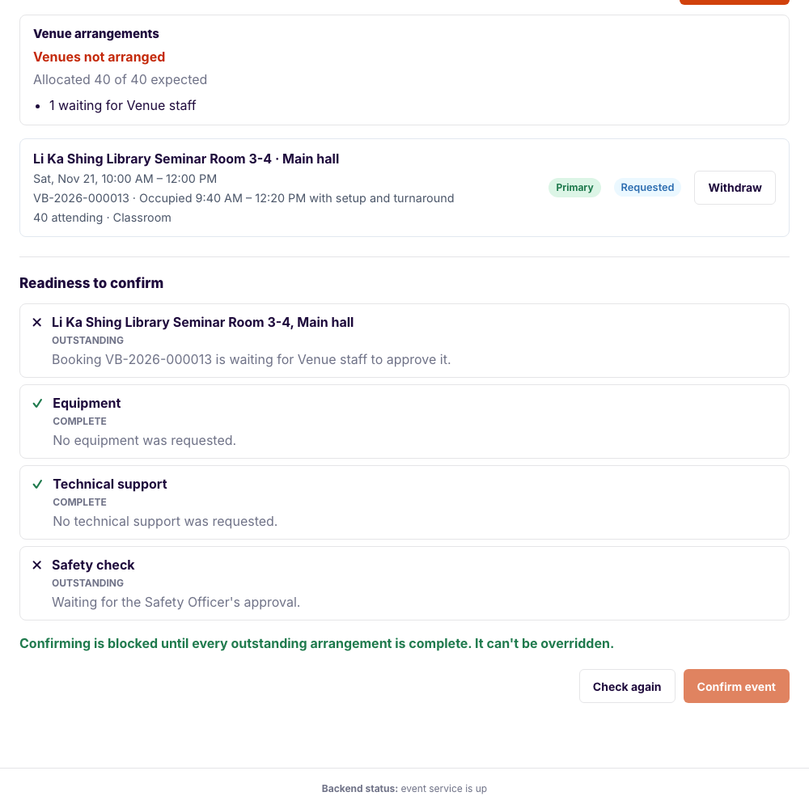
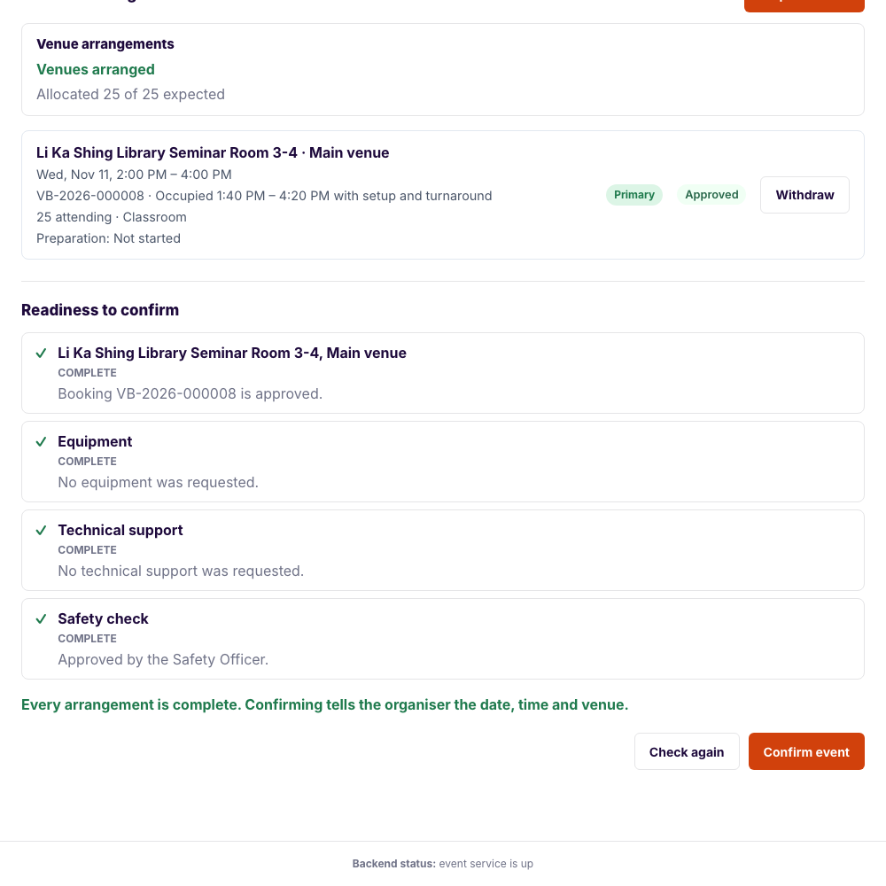
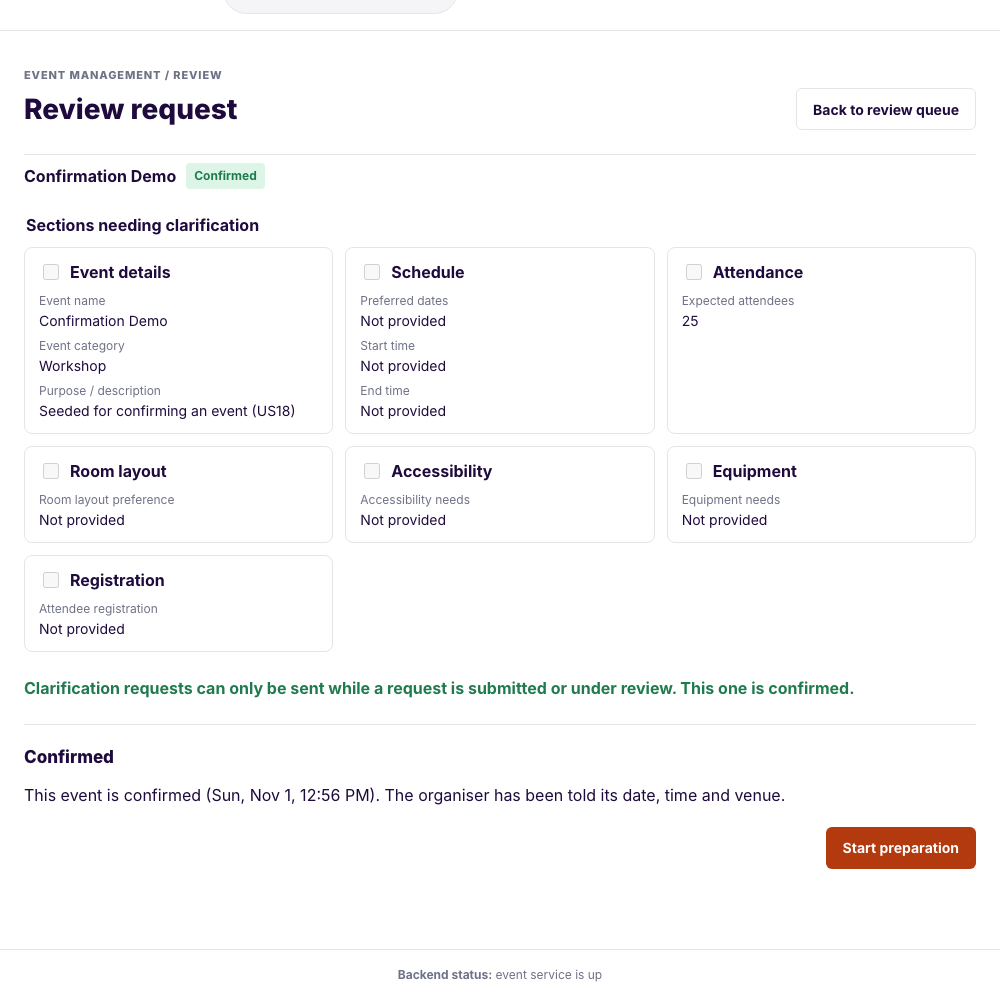
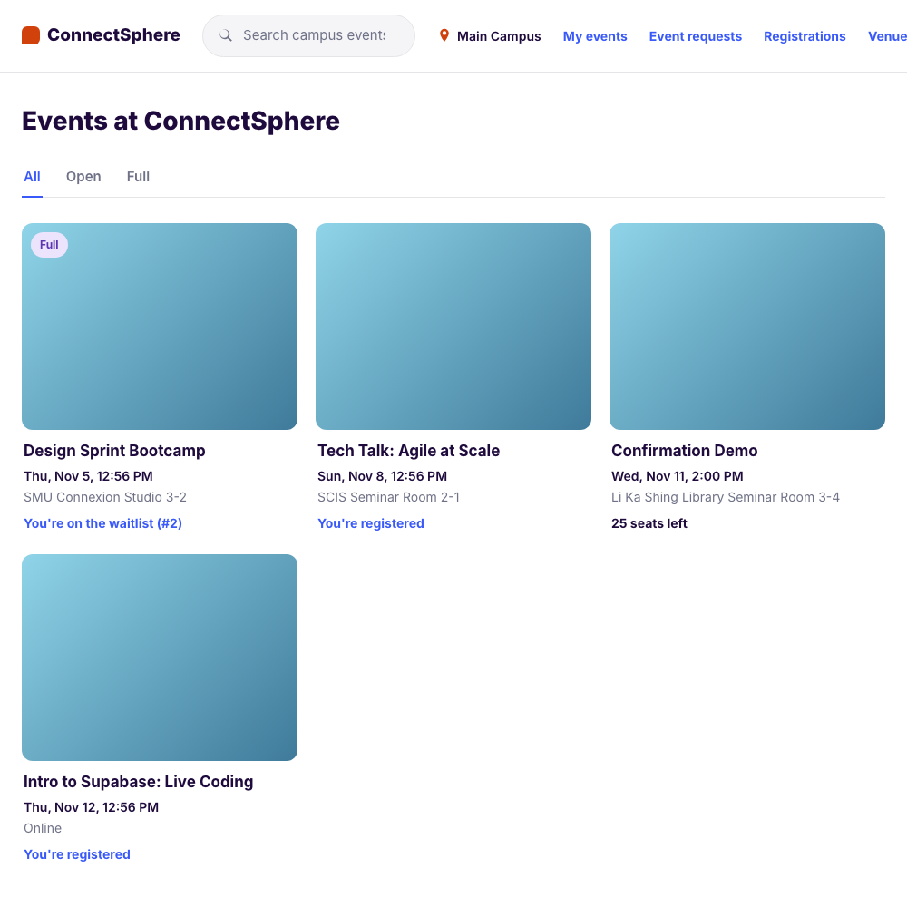
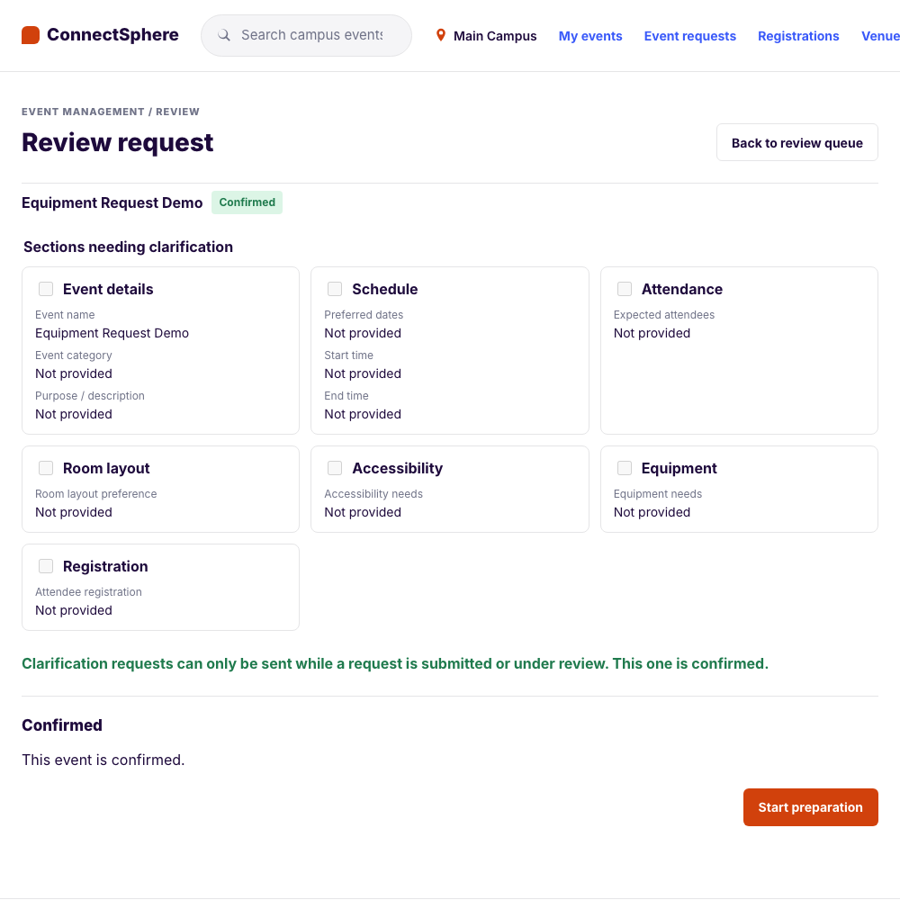
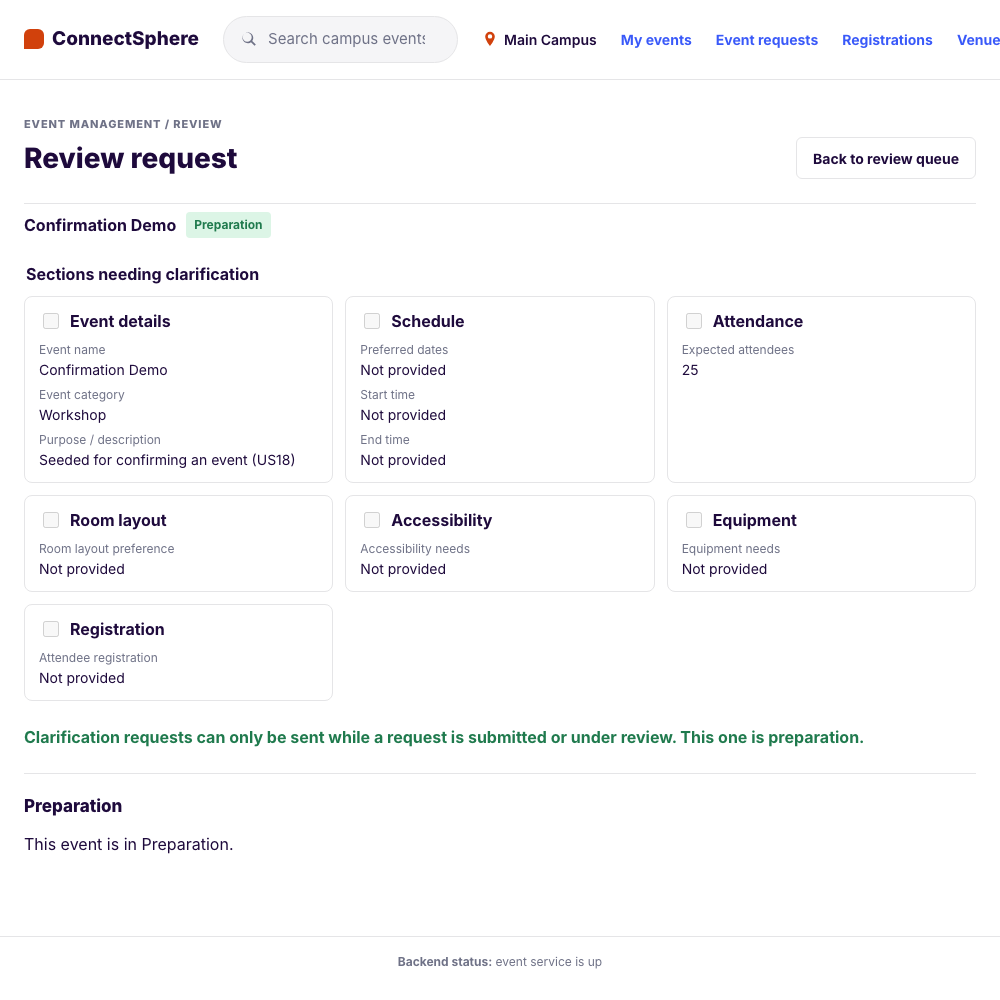

# US18 — Confirm an event (SCRUM-85): test cases

**Story:** As an Event Coordinator, I want to confirm an event once its essential arrangements are complete so that the Organiser and attendees can rely on it going ahead.

**Source of truth:** the acceptance criteria in Jira SCRUM-85 (customer session 3, 13 Oct).

**Delivery:** one PR. It adds the migration `20261109_1200_us18_confirm` (the `preparation` status, the safety approval and confirmation columns on `events`), `GET /api/v1/event-requests/{id}/readiness`, `POST …/confirmation` and `POST …/preparation`, `Notifier.event_confirmed`, the readiness panel on the coordinator's review screen, and the seeded **Confirmation Demo**. US30a (SCRUM-99) is stacked on it and sets the safety approval.

**Tests:**

- Backend: `backend/tests/event/test_confirmation.py` (TC-US18-01 to 29, 38 to 43)
- Frontend: `frontend/src/features/eventRequest/confirmation.integration.test.tsx` (TC-US18-31 to 37, 44)
- E2E: `e2e/tests/event-confirmation.spec.ts` (TC-US18-30). It confirms the seeded Confirmation Demo, so a rerun needs a reseed (`python -m app.seed`)

## Acceptance criteria

1. Can confirm an event only when every required arrangement is complete: each required venue booking approved, any requested equipment reserved, technical support arranged, and the safety check approved
2. Sees a readiness list, per venue and for equipment and safety, showing which arrangements are complete and which are outstanding when confirmation is blocked
3. Moves the event to Confirmed, after which registration can open if it's enabled
4. Causes the Organiser to be notified that the event is confirmed, with the confirmed date, time and venue(s)
5. Cannot confirm an event that is Cancelled, Rejected or already Confirmed, and cannot override an incomplete arrangement
6. Can move a Confirmed event to Preparation (the Venue staff and Technical support preparation updates it unlocks are not built yet)

## Decisions

- **D86: what can be confirmed, and what is "ready".** `approved` or `planning`; venues arranged as US24 defines it (D72), equipment approved and reserved, Tech support staff assigned once the event has an approved equipment line (D80), and the Safety Officer's approval. See `claude_instructions.md`
- **Order of checks:** not the assigned coordinator, unassigned, a draft or unknown → `404`; a status that can't be confirmed → `409 CONFIRMATION_NOT_ALLOWED`; an arrangement outstanding → `409 EVENT_NOT_READY` with the outstanding items. On any refusal nothing changes and nobody is notified

## Test cases

| ID | Given | When | Then |
|---|---|---|---|
| TC-US18-01 | Approved event, every arrangement complete | Coordinator confirms | `200`, `confirmed`, `confirmed_at` and `confirmed_by_user_id` set (AC 3) |
| TC-US18-02, 03 | Two approved bookings; an event with its own date and capacity | Confirm | Date span, capacity (expected attendance) and in-person filled, `venue_name` left alone (D70); existing values kept (D86) |
| TC-US18-04 | Planning event | Confirm | `200` (D86) |
| TC-US18-05 to 07 | A requested booking; no venue; rejected and withdrawn bookings | Confirm | `409 EVENT_NOT_READY` naming the venue; "No venue has been requested yet."; the rejected and withdrawn are ignored (AC 1) |
| TC-US18-08, 09 | A pending equipment line (one approved); none requested | Confirm | `409` naming "1 of 2 equipment lines" and technical support; a rejected line stops blocking, the approved one still needs reserving and staff; no equipment does not block (AC 1) |
| TC-US18-10, 11 | No safety approval; venue, equipment and safety all outstanding | Confirm | `409`; all three listed with the complete ones too (AC 1, 2) |
| TC-US18-12 | One approved and one requested venue | Read readiness | Per venue complete or outstanding, then equipment and safety (AC 2) |
| TC-US18-13 | Cancelled, rejected, confirmed, preparation, completed, under review, awaiting clarification, submitted | Confirm | `409 CONFIRMATION_NOT_ALLOWED`, nothing changes (AC 5) |
| TC-US18-14, 15 | An override body; confirming twice | Confirm | `409`, ignored; the second is `CONFIRMATION_NOT_ALLOWED` (AC 5) |
| TC-US18-16 | Under-review event | Read readiness | `409` |
| TC-US18-17 to 19 | Confirm; refused; notifier raises | — | The organiser told reference, name, start, end and venues; no notice on a refusal; `200`, the confirmation stands, the failure logged (AC 4) |
| TC-US18-20, 21 | Another coordinator, a Lead, an organiser, nobody; unassigned, draft, unknown | Confirm, read | `404`, `403`, `403`, `401`; `404` (D48) |
| TC-US18-22, 23 | Planning, Confirmed, Preparation | The assigned coordinator opens it, its thread and the queue; another coordinator and a Lead | `200` and listed; `404` and absent (D11 widened) |
| TC-US18-24 to 26 | Confirmed event; other statuses; another coordinator | Start preparation | `preparation`; `409 PREPARATION_NOT_ALLOWED`; `404`, `401` (AC 6) |
| TC-US18-27 | Event in Preparation, registration on | Attendee lists the board | It is listed (AC 3) |
| TC-US18-28 | Safety approval with one column set | Insert | The database refuses it |
| TC-US18-29 | Seeded Confirmation Demo | Confirm, reseed, confirm | Ready and confirmable; the reseed puts it back to Approved |
| TC-US18-30 | Seeded Confirmation Demo (E2E) | Coordinator opens it, confirms, starts Preparation | Three complete items; Confirmed, then Preparation |
| TC-US18-31 | Frontend: approved event, all complete | Open it, Confirm event | Three Complete items, the POST sent, "Confirmed" shown |
| TC-US18-32 | Frontend: pending booking and equipment, no safety | Open it | Three Outstanding items with their reasons; Confirm disabled and nothing sent (AC 1, 2, 5) |
| TC-US18-33 | Frontend: safety approved meanwhile | Check again | Confirm enabled |
| TC-US18-34 | Frontend: API says `EVENT_NOT_READY` | Confirm | Alert, and the list is read again |
| TC-US18-35 | Frontend: confirmed event | Start preparation | "Preparation" shown (AC 6) |
| TC-US18-36 | Frontend: planning event | Open it | Request venue and the readiness list both show (D11 widened) |
| TC-US18-37 | Frontend: under-review event | Open it | No readiness list, no readiness call |
| TC-US18-38 | Online event | Confirm | No venue needed (D72); confirms with its own dates |
| TC-US18-39, 40 | Approved bookings with no primary; allocations short of the expected attendance | Confirm | `409` naming "Primary venue"; "Attendance allocated" (US24 D67, D68) |
| TC-US18-41, 42 | An approved, reserved equipment line; staff assigned, then unassigned | Confirm | `409` "No Tech support staff member is assigned yet." until one is active; unassigned staff don't count (D80) |
| TC-US18-43 | Approved, requested, none, no primary, short, online | Read readiness | The venue items agree with `venues_arranged` (D72) |
| TC-US18-44 | Frontend: approved, reserved equipment, no staff | Open it, assign staff, Check again | Technical support outstanding and Confirm disabled; then enabled |

## Evidence

Taken from the running app against a fresh local database (migrated and seeded), acting as the seeded coordinator Casey Tan, at the commit that adds these files. The organiser's notice is log-only, so it is shown as the log line the backend wrote.

### AC 1, 2: blocked, with what is outstanding

Venue Booking Demo, with a venue requested but not yet approved by Venue staff. The venue and the safety check are Outstanding; equipment and technical support are Complete because none was requested; Confirm event is disabled.



The API refuses the same event (`POST /api/v1/event-requests/{id}/confirmation`), naming what is outstanding:

```
409 {"code": "EVENT_NOT_READY", "outstanding": [
  {"kind": "venue", "name": "Li Ka Shing Library Seminar Room 3-4, Main hall", ...},
  {"kind": "safety", "name": "Safety check", ...}]}
```

### AC 1, 2: every arrangement complete

Confirmation Demo: approved venue booking, no equipment or technical support requested, safety approved.



### AC 3: confirmed



With registration enabled for the event, an attendee finds Confirmation Demo on the events board, at the date and venue it was confirmed with:



### AC 4: the organiser is told

```
INFO app.notification.service: event confirmed: event.organiser@smu.edu.sg, no reference yet (Confirmation Demo) from 2026-11-11T06:00:00+00:00 to 2026-11-11T08:00:00+00:00 at Li Ka Shing Library Seminar Room 3-4
```

### AC 5: an event that is already confirmed

Equipment Request Demo is already Confirmed: the panel offers no Confirm event, and the API refuses it.



```
409 {"code": "CONFIRMATION_NOT_ALLOWED", "status": "confirmed"}
```

### AC 6: Preparation



## Run log

| Date | Where | Result |
|---|---|---|
| 1 Nov 2026 | Backend, `pytest`, rebased onto `main` at #107 | 1331 passed |
| 1 Nov 2026 | Frontend, Vitest, lint, build | 434 passed; lint and build clean |
| 1 Nov 2026 | E2E, TC-US18-30 with the US12, US17 and equipment journeys, fresh local database | 12 passed; the rest of the suite was not run |
