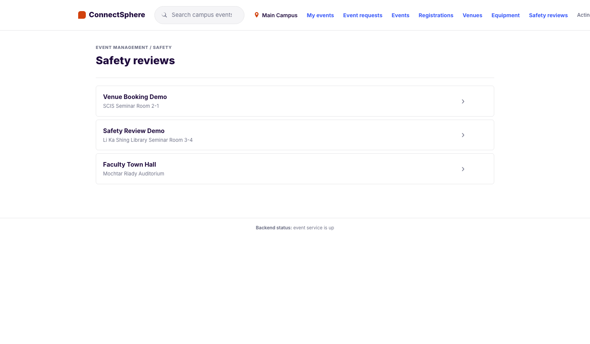
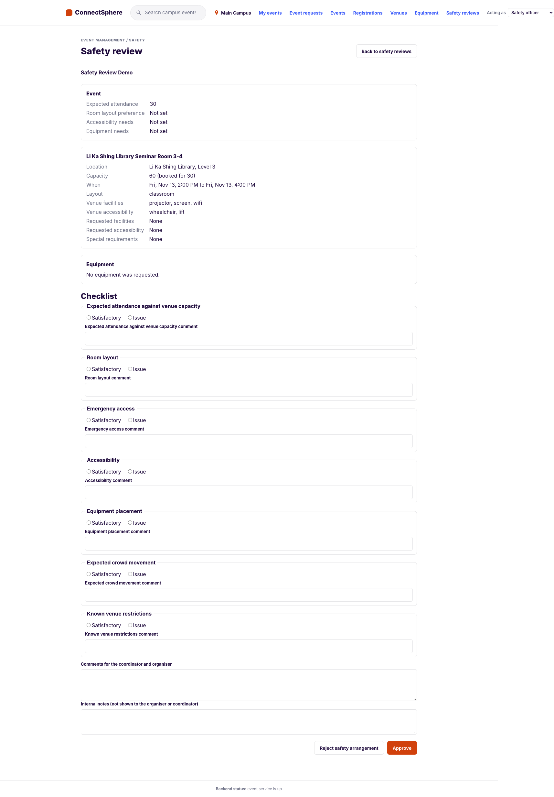
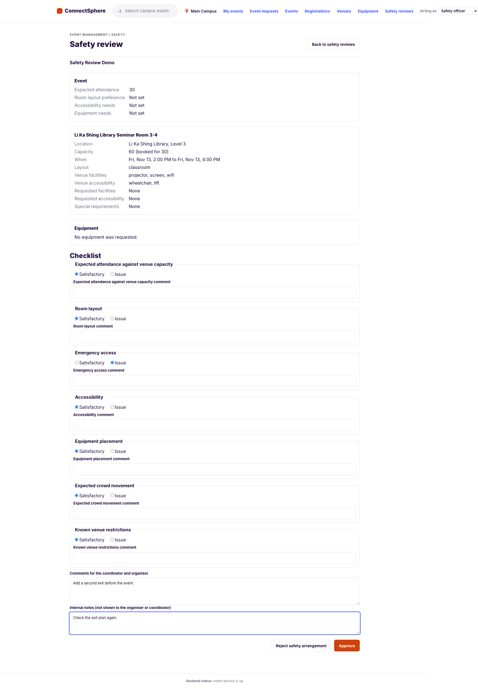
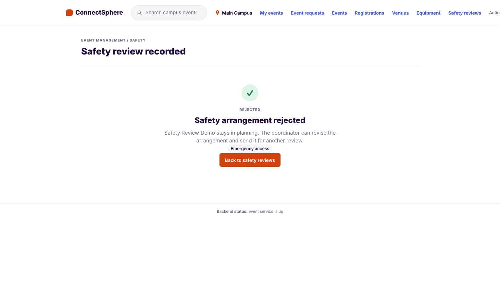
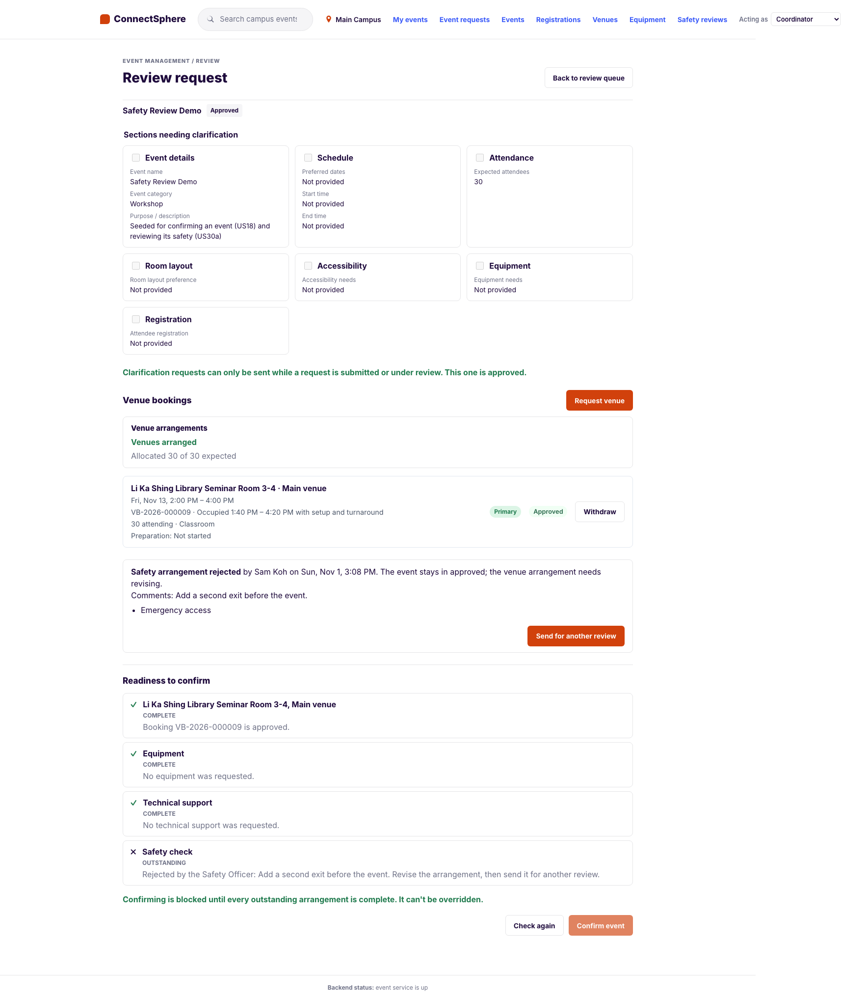
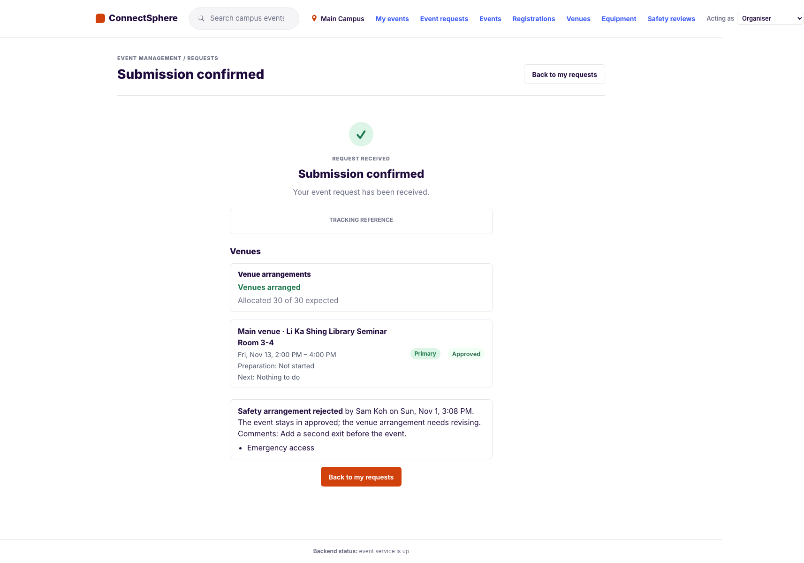
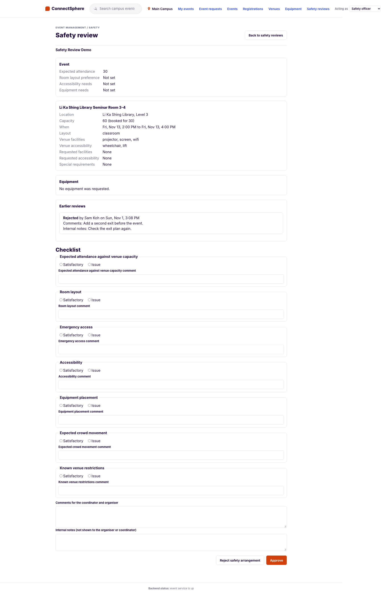
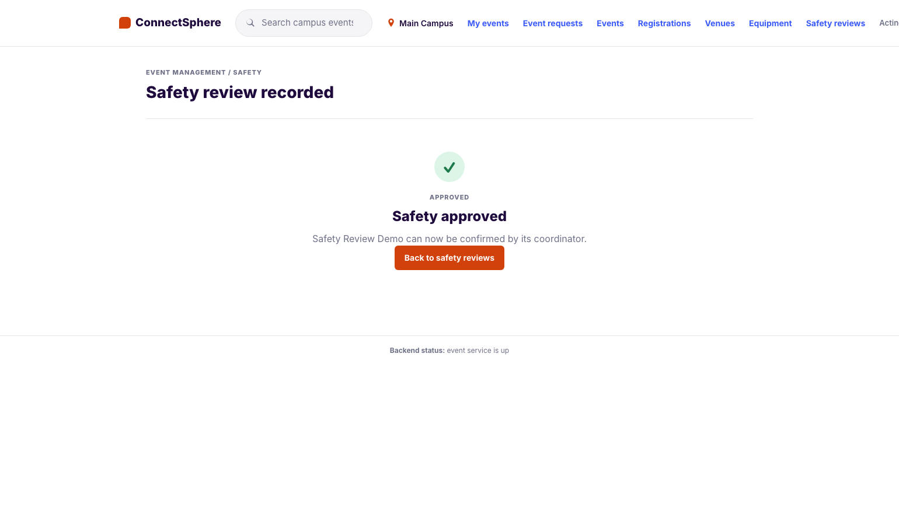
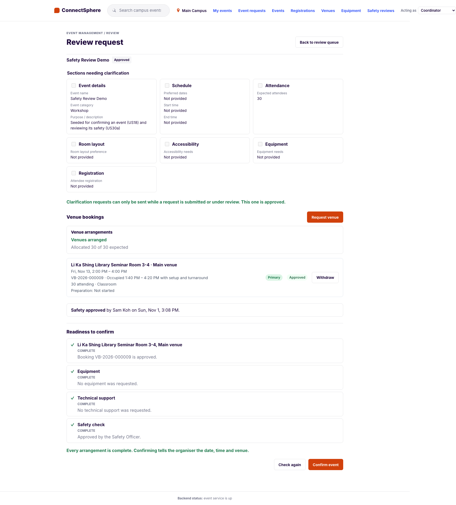
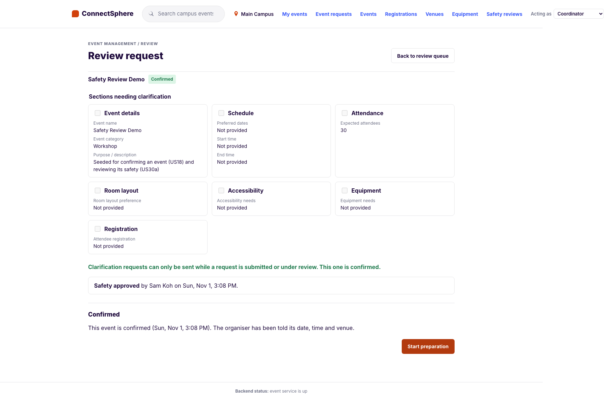

# US30a — Operational safety review, approve or reject (SCRUM-99): test cases

**Story:** As a Safety Officer, I want to review an event's safety arrangement and approve or reject it so that no event goes ahead with an unsafe setup.

**Source of truth:** the acceptance criteria in Jira SCRUM-99. The numbering below is the one `claude_instructions.md` uses.

**Delivery:** one PR, built on SCRUM-85 (US18). It adds the migration `20261110_1200_us30a_safety` (the `safety_reviews` table and `events.safety_review_requested_at`), the Safety Officer's queue, review view and decision (`GET /api/v1/safety-reviews`, `GET …/{event_id}`, `POST …/{event_id}`), the organiser's and coordinator's outcome (`GET /api/v1/event-requests/{id}/safety-reviews`), the coordinator's **Send for another review** (`POST …/safety-review-request`), `Notifier.safety_review_decided`, the Preparation guard, and the seeded **Safety Review Demo**. US18's confirm needs the approval this sets.

**Tests:**

- Backend: `backend/tests/safety/test_safety_review.py` (TC-US30A-01 to 31 and 49)
- Frontend: `frontend/src/features/safety/safetyReview.integration.test.tsx` (TC-US30A-40, 42 to 48)
- E2E: `e2e/tests/safety-review.spec.ts` (TC-US30A-41). It uses the seeded Safety Review Demo, so a rerun needs a reseed (`python -m app.seed`)

## Acceptance criteria

1. The Safety Officer sees a queue of events whose venues are arranged and whose requested equipment is approved and reserved, with no safety decision yet
2. Opening one shows the checklist: expected attendance against venue capacity, room layout, emergency access, accessibility, equipment placement, expected crowd movement and known venue restrictions
3. Approving records the review and lets the coordinator confirm the event
4. Rejecting needs comments and rejects the venue arrangement, not the event
5. The coordinator is notified of the outcome, with the comments and the flagged items
6. Each review is recorded with the reviewer, outcome, checklist, comments and time, and none is deleted
7. The organiser and coordinator read the outcome and comments, never the internal notes
8. An event without an approved safety review can't move to Preparation
9. The Safety Officer sees only the event details a review needs

## Decisions

- **D92: the safety state is derived, not a status.** From `safety_reviews`, `events.safety_approved_at` and `events.safety_review_requested_at`; an approval can't carry an item marked `issue` and is final. See `claude_instructions.md`
- **Deviation 62:** US30b (request changes) and a change log of attendance, venue, access and equipment edits are not built; the Safety Officer sees the earlier reviews as the history
- **D51:** a Safety Officer who created or coordinates the event can't review it (`403 SELF_DECISION_NOT_ALLOWED`)

## Test cases

| ID | Given | When | Then |
|---|---|---|---|
| TC-US30A-01 to 04 | Arranged venues, no equipment pending, no decision; one that isn't ready, is decided, or is under review; an approved equipment line, unreserved then reserved; a planning event | Safety officer reads the queue | Only the ready one is listed, with name, reference, venues and start; equipment waiting to be reserved keeps it out (AC 1) |
| TC-US30A-05, 06 | A queued event with an approved equipment line; one not queued and never reviewed, a draft, an unknown id | Open it | Only the review fields, the venues, the equipment and the seven items; `404` (AC 2, 9) |
| TC-US30A-07 | Queued event | Approve | `201`; one row with reviewer, outcome, checklist and time; `safety_approved_at` and `_by` set; the status unchanged; the coordinator can now confirm (AC 3, 6) |
| TC-US30A-08 | Approve with an item marked issue | — | `422 CHECKLIST_HAS_ISSUES`; nothing stored |
| TC-US30A-09 | Reject with an issue and comments | — | `201`; the event keeps its status and isn't approved; the coordinator's readiness shows the comments; confirming is `409` (AC 4) |
| TC-US30A-10 to 13 | No, empty or blank comments on a rejection; no outcome or an item missing; an unknown item; the database | Review | `422 MISSING_REQUIRED_FIELD` naming `comments`; naming `outcome` and `checklist.<key>`; `INVALID_SAFETY_REVIEW`; both CHECKs refuse (AC 2, 4) |
| TC-US30A-14 to 18 | Under review, confirmed, preparation, cancelled, rejected; an arrangement outstanding; already approved; rejected, not yet sent back; a draft or unknown id | Review | `409` with each `reason`; `404` |
| TC-US30A-19 to 22 | A rejected arrangement | The coordinator sends it back; nothing to send, already sent, approved; another coordinator, organiser, officer; reject, send back, approve | Back in the queue marked `resent`, readiness says "Sent for another safety review."; `409` `not_rejected`, `already_requested`, `already_approved`; `404`, `403`, `403`, `401`; confirmed in the end (AC 4) |
| TC-US30A-23 | Reject, then another officer approves | Read the history | Both reviews kept, newest first, with reviewer, outcome, comments, time; internal notes only here (AC 6) |
| TC-US30A-24, 25 | Reject; a refused review; a failing notifier | — | The coordinator told the outcome, comments and flagged labels; no notice on a refusal; `201`, the review kept, the failure logged (AC 5) |
| TC-US30A-26, 27 | Rejected event | Organiser and coordinator read the outcome; another organiser or coordinator, an officer, nobody | Outcome and comments, no `internal_notes` anywhere in the body; `404`, `404`, `403`, `401` (AC 7) |
| TC-US30A-28, 29 | Coordinator, organiser, Venue staff, Lead, nobody; an officer who created or coordinates the event | Queue, open, review | `403`, `401`; `403 SELF_DECISION_NOT_ALLOWED` (D51) |
| TC-US30A-30 | A Confirmed event with no approved review | Start preparation | `409 SAFETY_NOT_APPROVED`; allowed once approved (AC 8) |
| TC-US30A-31 | Seeded Safety Review Demo | Review, reseed | It is queued; approving removes it; the reseed forgets its reviews and queues it again |
| TC-US30A-40 | Screens | Safety officer's screens | Safety reviews only; no other role has it |
| TC-US30A-41 | Seeded Safety Review Demo (E2E) | Officer rejects with an issue and internal notes; coordinator reads it and sends it back; officer sees the earlier review with notes and approves; coordinator confirms | Coordinator sees the comments and not the notes, Confirm disabled until approval, then Confirmed |
| TC-US30A-42, 43 | Frontend: ready, not ready, decided events | Officer opens Safety reviews | Only the ready event is listed; "No events are waiting for a safety review." |
| TC-US30A-44 | Frontend: queued event | Open it | Event details, venue, equipment and seven items; nothing about the organiser (AC 2, 9) |
| TC-US30A-45 | Frontend: all items satisfactory | Approve | The POST holds outcome, comments, notes and seven items; "Safety approved"; the event leaves the queue |
| TC-US30A-46 | Frontend: nothing answered; a rejection without comments | Approve, Reject | The alert, the comments field marked, nothing sent |
| TC-US30A-47 | Frontend: an issue and comments | Reject | "Safety arrangement rejected", stays in planning, the issue listed; an API `CHECKLIST_HAS_ISSUES` is explained |
| TC-US30A-48 | Frontend: a rejected event | Organiser and coordinator open it | Outcome, comments and issues, never the internal notes; the coordinator's **Send for another review** posts and the panel says "Sent for another safety review." |
| TC-US30A-49 | An online approved event with no booking, beside a queued in-person one | Safety officer reads the queue | Both are listed; the online one has no venues and no start (D72); the queue doesn't fail (AC 1) |

## Evidence

Taken from the running app against a fresh local database (migrated and seeded), at the commit that adds these files. The screens were driven in the order of TC-US30A-41 on the seeded **Safety Review Demo**: the Safety officer rejects it, the coordinator and organiser read why, the coordinator sends it back, the Safety officer approves it, and the coordinator confirms it. The coordinator's notice is log-only, so AC 5 is shown by TC-US30A-24 rather than a screenshot.

### AC 1: the queue

The seeded Safety Officer's queue. Safety Review Demo is listed with its venue. Venue Booking Demo and Faculty Town Hall appear too, because they also have an approved booking, no equipment waiting and no decision yet.

### AC 2, 9: the review and its checklist

Only what a review needs: attendance, layout and accessibility needs, the venue with its capacity (booked for 30 of 60) and features, the equipment, and the seven checklist items. No organiser name or contact.

### AC 4: reject with comments

Emergency access marked Issue, comments for the coordinator and organiser, and internal notes.

The event stays where it was; the venue arrangement is what is rejected.

### AC 4, 7: the coordinator and the organiser read why

The coordinator sees the comments and the flagged item, the Safety check Outstanding in the readiness list, Confirm event disabled, and **Send for another review**. The internal notes are not shown.

The organiser sees the same outcome and comments on their request.

### AC 6: the earlier review is kept

After the coordinator sends it back, the Safety officer sees the earlier review with its comments, flagged item and internal notes (which only the Safety officer can read).

### AC 3: approve

The coordinator's Safety check is now Complete and Confirm event is enabled:

### AC 5, 8: not screenshotted

The coordinator's notice (log-only) is TC-US30A-24 and 25, and the Preparation guard is TC-US30A-30: an event with no approved review gets `409 SAFETY_NOT_APPROVED` when started on Preparation.

## Run log

| Date | Where | Result |
|---|---|---|
| 1 Nov 2026 | Backend, `pytest`, rebased onto `main` at 742f6d4 | 1433 passed |
| 1 Nov 2026 | Frontend, Vitest, lint, build | 452 passed; lint and build clean |
| 1 Nov 2026 | E2E, the full suite against a fresh local database | 50 passed, 10 skipped (the Supabase login and sign-up cases, which need credentials), 0 failed |
