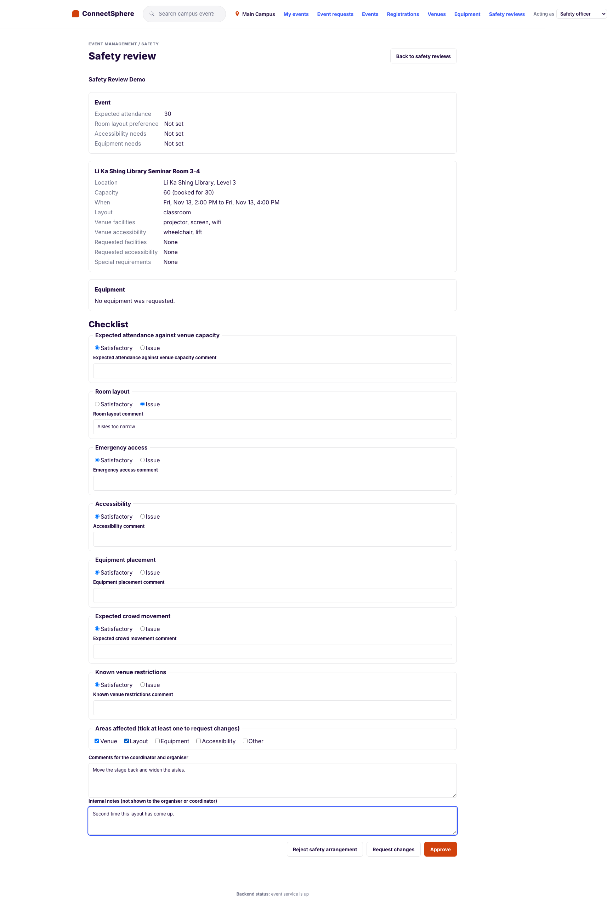
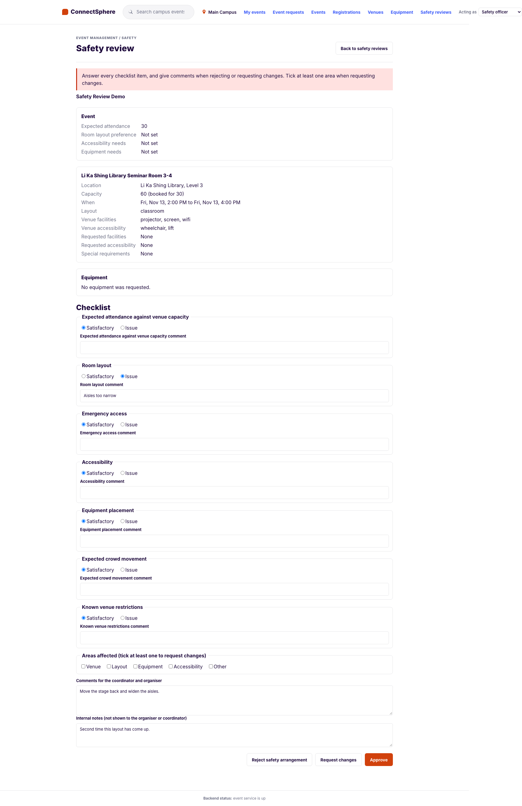
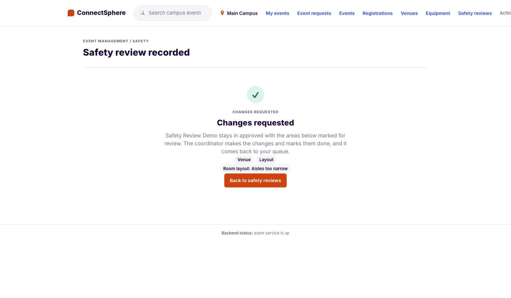
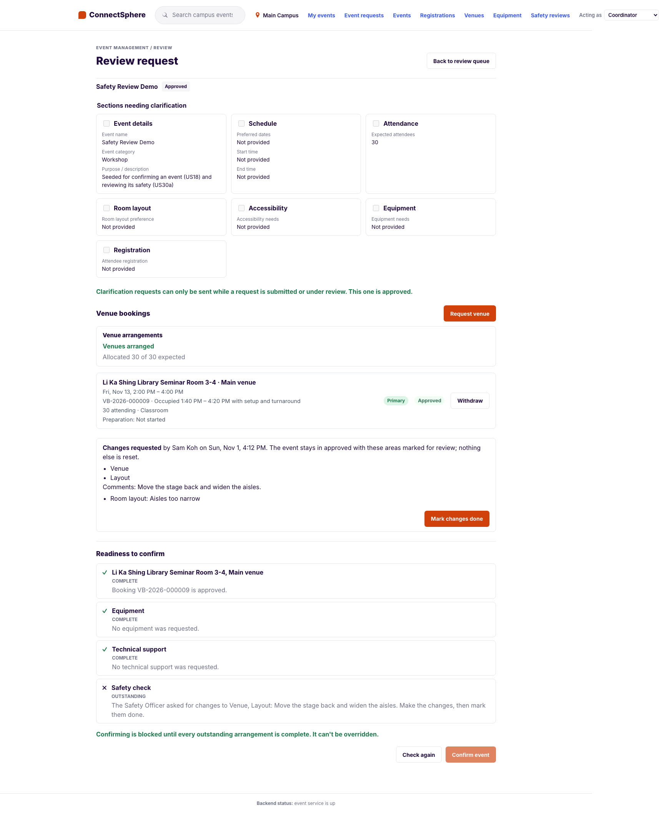
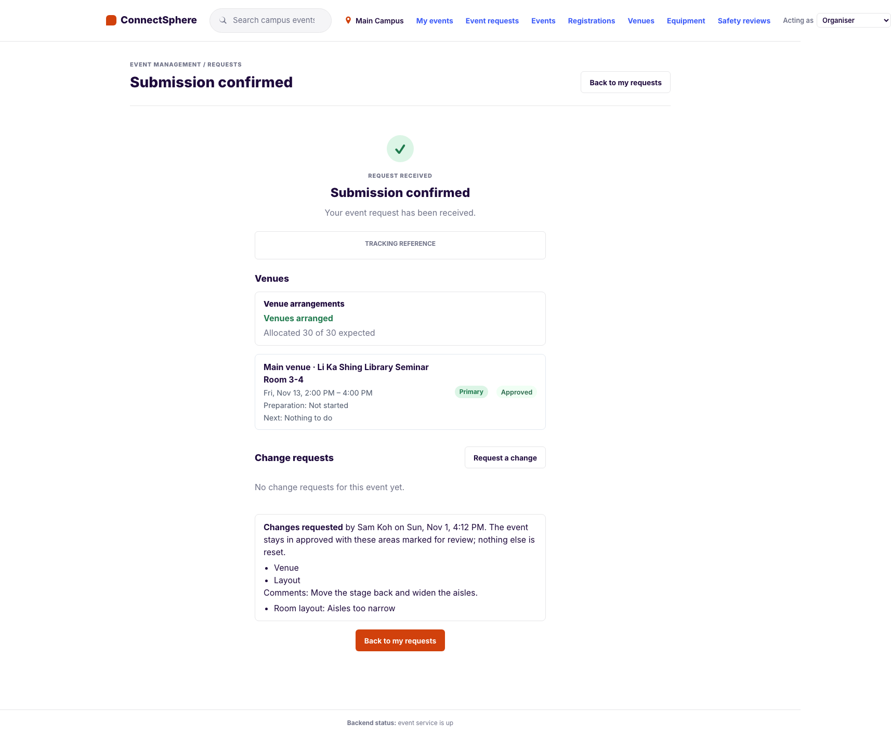
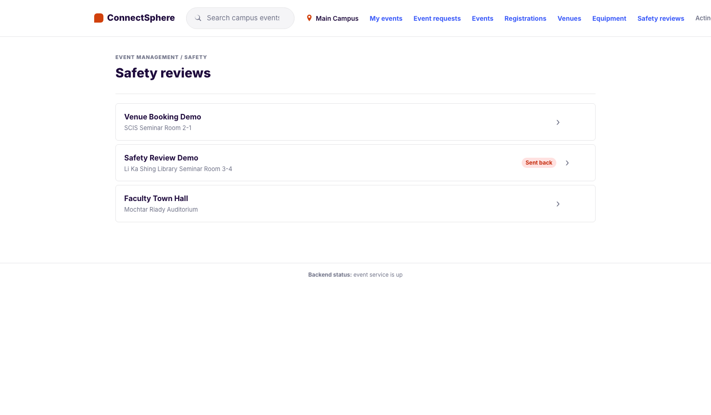
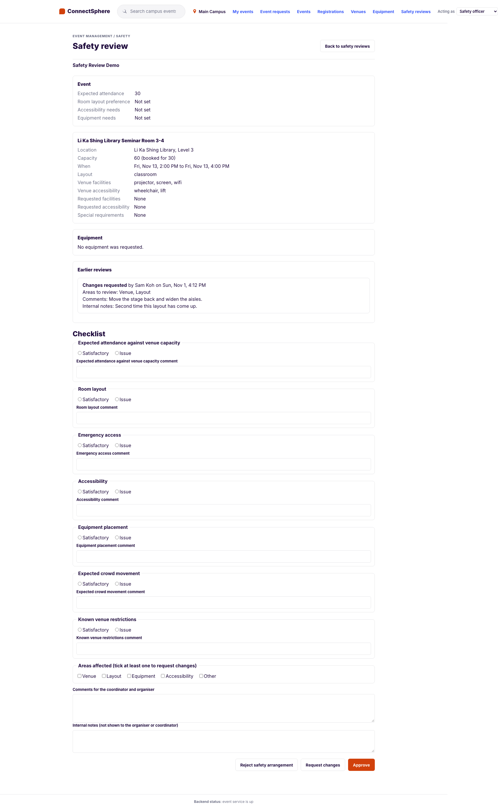
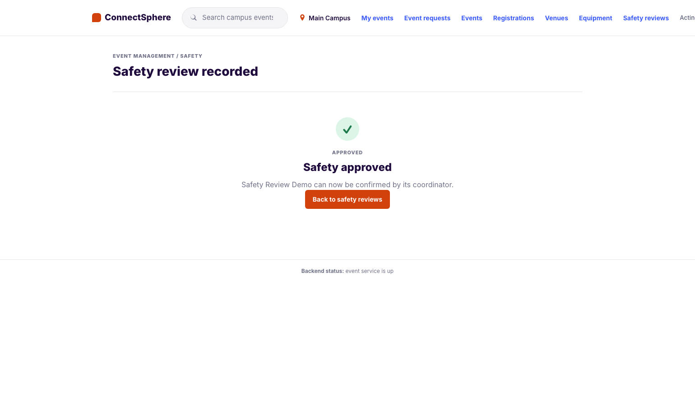

# US30b — Request changes after a safety review (SCRUM-100): test cases

**Story:** As a Safety Officer, I want to request specific changes to an event's arrangements so that it can be made safe instead of rejected outright.

**Source of truth:** the acceptance criteria in Jira SCRUM-100, with the 13 Oct change (customer clarification session 3): after a request for changes the event stays in Planning until all approvals are done, and nothing is reset automatically; the Event Coordinator makes the changes if needed.

**Delivery:** one PR, stacked on SCRUM-99 (US30a). It adds the migration `20261113_1200_us30b_changes` (`safety_reviews.areas`, the `changes_requested` outcome and a CHECK that it carries comments and an area), the `changes_requested` outcome and `areas` on `POST /api/v1/safety-reviews/{event_id}`, `Notifier.safety_changes_requested`, the readiness wording, and on the screens **Request changes** with the **Areas affected** tick boxes, the areas on the organiser's and coordinator's **Safety review** panel, and **Mark changes done**. Marking changes done is US30a's send-back (`POST …/safety-review-request`).

**Tests:**

- Backend: the US30b section of `backend/tests/safety/test_safety_review.py` (TC-US30B-01 to 19)
- Frontend: `frontend/src/features/safety/safetyReview.integration.test.tsx` (TC-US30B-31 to 37 and TC-US30A-50)
- E2E: `e2e/tests/safety-review.spec.ts` (TC-US30B-30). It is one journey with US30a's (TC-US30A-41), because both use the seeded Safety Review Demo and the specs run in parallel. A rerun needs a reseed (`python -m app.seed`)

## Acceptance criteria

1. The Safety Officer can choose "Request changes", must enter comments, and must tick which areas are affected (venue, layout, equipment, accessibility, other)
2. The event stays in (or returns to) Planning with the ticked areas marked for review. Venue and technical sign-offs are not reset automatically; the Coordinator decides what to change
3. The Event Coordinator is notified with the comments and affected areas
4. The event comes back into the Safety Officer's queue once the coordinator marks the changes done, and must be reviewed again; the earlier review stays in the history

## Decisions

- **D99: what "request changes" does and who says the changes are done.** A review with comments and at least one area; it records the review and changes nothing else. The coordinator's **Mark changes done** puts it back in the queue. Decided by the acting PO on 1 Nov 2026 (the event stays where it is). See `claude_instructions.md`
- **Deviation 64:** the event's status doesn't move (nothing moves an approved request to Planning, D53, and an approval is final, D92), nothing is reset, and the seven checklist items are still answered. See `claude_instructions.md`

## Test cases

| ID | Given | When | Then |
|---|---|---|---|
| TC-US30B-01 | A queued approved event | Safety officer requests changes (venue, layout), with comments | `201`; one `changes_requested` row with the areas in the form's order; the status unchanged; no safety approval; the readiness list says what was asked, and confirming is `409` (AC 1, 2) |
| TC-US30B-02 | A planning event | Request changes | It stays `planning` (AC 2) |
| TC-US30B-03 | No, empty, or blank comments; no or empty areas | Request changes | `422 MISSING_REQUIRED_FIELD` naming `comments`, `areas` or both; nothing stored (AC 1) |
| TC-US30B-04, 05 | An unknown area; areas on an approval or a rejection; a repeated area | Review | `422 INVALID_SAFETY_REVIEW` naming `areas`; the repeated one is kept once, in the form's order |
| TC-US30B-06 | No checklist; a checklist with no issues | Request changes | `422` for the first; `201` for the second (the seven items are still answered) |
| TC-US30B-07 | A `changes_requested` row with no or blank comments, no or empty areas | Insert | The database refuses it |
| TC-US30B-08 | An approved booking and a reserved equipment line | Request changes (venue, equipment) | Nothing is reset: the line, the booking and the readiness of both stay complete (AC 2, the 13 Oct change) |
| TC-US30B-09, 10 | Request changes; a refused request; a failing notifier | — | The coordinator told by `safety_changes_requested` with the comments, the area labels and the flagged items, and not by `safety_review_decided`; no notice on a refusal; `201`, the review kept, the failure logged (AC 3) |
| TC-US30B-11 | Changes requested | Officer lists the queue; reviews again | It's gone; `409 awaiting_revision` (AC 4) |
| TC-US30B-12 | Changes requested | The coordinator marks them done | `200`, `pending`; back in the queue marked sent back; the readiness list says "Sent for another safety review." (AC 4) |
| TC-US30B-13 | Changes requested, marked done | The officer approves | `201`; the history keeps both, newest first, with the areas and the internal notes; the coordinator can confirm (AC 4) |
| TC-US30B-14 | A second request for changes after the first was marked done | Read the outcome | State `changes_requested`; both reviews listed with their areas |
| TC-US30B-15 | Changes requested | Another coordinator, an organiser, the officer, nobody; the assigned coordinator twice | `404`, `403`, `403`, `401`; `200`, then `409 already_requested` |
| TC-US30B-16 | Changes requested | Organiser, coordinator and Lead read the outcome | State, areas and comments; no `internal_notes` anywhere in the body (AC 3) |
| TC-US30B-17 | A coordinator and an organiser; nobody; an officer who coordinates the event | Request changes | `403`; `401`; `403 SELF_DECISION_NOT_ALLOWED` (D51) |
| TC-US30B-18 | Under review, confirmed, preparation, cancelled, rejected | Request changes | `409` reason `status`; nothing stored |
| TC-US30B-19 | Seeded Safety Review Demo | Request changes, reseed | `201`; the reseed forgets it and queues the demo again |
| TC-US30B-30 | Seeded Safety Review Demo (E2E) | Officer rejects; the coordinator sends it back; the officer requests changes (venue, layout); the coordinator sees them and marks them done; the officer sees the earlier review and approves; the coordinator confirms | The coordinator sees the areas and comments, Confirm disabled until approval; the officer's second review shows "Areas to review: Venue, Layout"; then Confirmed |
| TC-US30B-31 | Frontend: queued event | Open it | The five area tick boxes (Venue, Layout, Equipment, Accessibility, Other) and **Request changes** (AC 1) |
| TC-US30B-32 | Frontend: no area, or no comments | Request changes | The alert, the comments field marked, nothing sent (AC 1) |
| TC-US30B-33 | Frontend: layout flagged, venue and equipment ticked, comments | Request changes | The POST holds the outcome, areas, comments and notes; "Changes requested" with the areas; the event leaves the queue (AC 1, 2) |
| TC-US30B-34 | Frontend: a request for changes | Organiser opens the event | The areas, the comments and the flagged item; never the internal notes; no button (AC 3) |
| TC-US30B-35 | Frontend: a request for changes | Coordinator opens the event | The readiness list says what was asked, Confirm is disabled; **Mark changes done** posts and the panel says "Sent for another safety review." (AC 3, 4) |
| TC-US30B-36 | Frontend: changes marked done | Officer opens the event | The earlier review is in the history with its areas and internal notes (AC 4) |
| TC-US30B-37 | Frontend: a planning event | Request changes | "Changes requested", and it says the event stays in planning |
| TC-US30A-50 | Frontend: an Approved event | Reject | "Safety arrangement rejected", and it says the event stays in approved, not planning |

## Evidence

Taken from the running app against a fresh local database (migrated and seeded), at the commit that adds these files, on the seeded **Safety Review Demo**. The coordinator's notice is log-only, so AC 3's notice is shown by TC-US30B-09 rather than a screenshot.

### AC 1: request changes, with comments and areas

The Safety Officer flags Room layout, ticks Venue and Layout under **Areas affected**, and writes comments and internal notes. **Request changes** sits beside **Reject safety arrangement** and **Approve**.

With no area ticked the request is refused, and the form says what is missing:

Sent:

### AC 2, 3: the event stays where it is, and the coordinator and organiser are told

The coordinator sees the areas (Venue, Layout), the comments and the flagged item. The event is still Approved, the venue, equipment and technical support items are still Complete (nothing was reset), the Safety check is Outstanding with what was asked, and Confirm event is disabled. **Mark changes done** is offered.

The organiser sees the same areas and comments, and never the internal notes.

### AC 4: back in the queue, reviewed again, and the earlier review stays

After the coordinator marks the changes done, the event is back in the Safety Officer's queue, marked **Sent back**.

The earlier review is in the event's history with its areas, comments and the internal notes only the Safety Officer can read.

The Safety Officer reviews it again and approves:

## Run log

| Date | Where | Result |
|---|---|---|
| 1 Nov 2026 | Backend, `pytest`, rebased onto `main` at SCRUM-12 | 1495 passed |
| 1 Nov 2026 | Frontend, Vitest, lint, build | 460 passed; lint and build clean |
| 1 Nov 2026 | E2E, the full suite against a fresh local database | 50 passed, 10 skipped (the Supabase login and sign-up cases, which need credentials), 0 failed |
