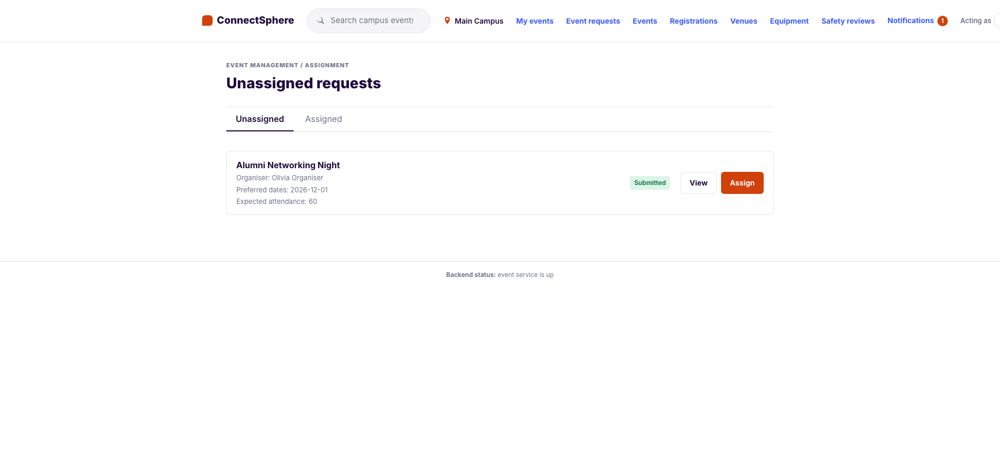
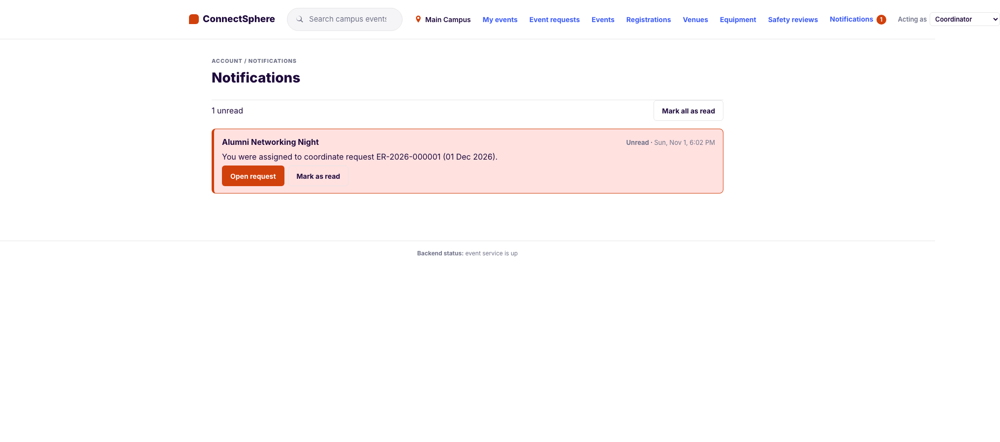
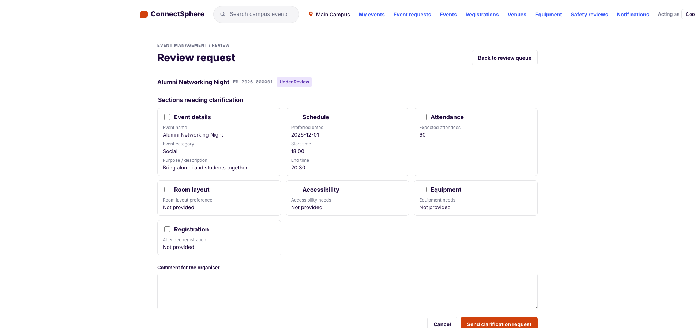
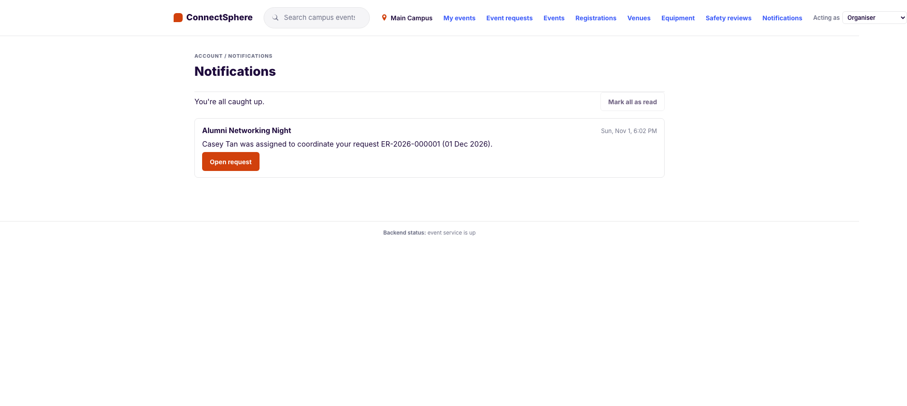

# US31 — View my notifications (SCRUM-107): test cases

**Story:** As a ConnectSphere user, I want to see the notifications sent to me in one place so that I don't miss significant changes to the events I'm involved in.

**Source of truth:** the acceptance criteria in Jira SCRUM-107. The numbering below follows the ticket.

**Delivery:** one PR. It adds the migration `20261116_1200_us31_notifications` (the `notifications` table), `RecordingNotifier` (the app's notifier now keeps a row for each recipient of every notice it raises, and still logs), `GET /api/v1/me/notifications`, `GET …/unread-count`, `POST …/{id}/read` and `POST …/read-all`, and on the screens a **Notifications** link on every role's header with the unread count, and the Notifications screen.

**Tests:**

- Backend: `backend/tests/notification/test_recorder.py` (TC-US31-01 to 10) and `test_inbox_api.py` (TC-US31-20 to 33)
- Frontend: `frontend/src/features/notifications/notifications.integration.test.tsx` (TC-US31-40 to 56) and `frontend/src/auth/screens.test.ts` (TC-US31-57)
- E2E: `e2e/tests/notifications.spec.ts` (TC-US31-60). It submits and assigns a request with a unique name, so it can run on a reused database

## Acceptance criteria

1. The user can open a Notifications view from any screen once logged in
2. The user sees only the notifications addressed to them, newest first, each with the event name, what happened and when
3. The user sees which notifications are unread, and an unread count on the Notifications link
4. The user can mark a notification, or all of them, as read
5. The user can open the related event (or request) from a notification, if their role allows them to view it
6. The user receives every notification the system already raises in this view, not only in the server log

## Decisions

- **D116: where notifications are written and what they hold.** By the notifier, when a story calls it, so every existing notice is kept without changing the stories. The table has no foreign keys, because a notice is written from its own session while the caller can still hold a lock on the event (a waitlist offer is sent inside the withdrawal's transaction), and the first version of this change made that request wait on itself. See `claude_instructions.md`
- **Deviation 74:** recipients are found by email; the event is found from what the notice carries; "Open" is the request, for who may read it, so attendees, Venue staff, Tech support and Safety officers get the notice with no link; wording is fixed when the notice is raised; no history before this change; the count polls every 30 seconds. See `claude_instructions.md`

## Test cases

| ID | Given | When | Then |
|---|---|---|---|
| TC-US31-01 | The `Notifier` protocol | List its methods | Every one is in the recorder's test table, so a new notice can't be raised without being kept (AC 6) |
| TC-US31-02 | Each of the 19 `Notifier` methods | Called with the recipient's email | One row for that user: the kind, the event name, the sentence, the event found from its id, reference, booking, equipment line or registration; the call is still logged through the wrapped notifier (AC 2, 6) |
| TC-US31-03 | The same address in another case | A notice | The same person's row |
| TC-US31-04 | An address no user holds | A notice | Nothing kept, a warning logged, the call still logged |
| TC-US31-05 | A reference no event has | A notice | Kept, with no event |
| TC-US31-06, 07 | No session can be opened; a row the database refuses | A notice | Logged, never raised; the session stays usable |
| TC-US31-08 | The app's `get_notifier` | Read it | The recording notifier over the logging one |
| TC-US31-09 | A Lead assigns a request | The coordinator and organiser list their notifications | Each has one, naming the event and what happened, unread; the Lead has none (AC 6) |
| TC-US31-10 | A transaction holding the event's row lock | A notice for that event | Recorded at once, without waiting for the lock |
| TC-US31-20 | Two of mine, one of someone else's | List | Mine only, newest first, with id, kind, event, event name, sentence, time, read and `can_open` (AC 2) |
| TC-US31-21 | Nothing | List | `200`, empty, `unread_count` 0 |
| TC-US31-22 | Every role, and a two-role user | List | Each their own; no identity `401`; inactive `403` (AC 1, 2) |
| TC-US31-23 | Five, one read | List with `limit=2`; the count route | Two listed; `unread_count` 4 and the count route agrees (AC 3) |
| TC-US31-24, 25 | Read and unread; `limit` 0, 101, abc | `unread_only`; list | Only the unread; `422` |
| TC-US31-26 | Two unread | Mark one read, twice | `200` both times, the first time kept, the count down by one (AC 4) |
| TC-US31-27 | Someone else's; an unknown id; no identity | Mark read | `404`; `404`; `401`; theirs stays unread |
| TC-US31-28 | Mine, read and unread, and someone else's | Mark all read, twice | `updated` 2 then 0; theirs untouched; `401` without identity (AC 4) |
| TC-US31-29 | The organiser, the assigned coordinator, a Lead, another organiser and coordinator, Venue staff; a draft; no event | List | `can_open` true for the first three, false for the rest and for a draft or no event; the notice names the event either way (AC 5) |
| TC-US31-30 | A notification with an event | Mark it read | The answer carries `can_open` too |
| TC-US31-31 | A blank kind or sentence | Insert | The database refuses it |
| TC-US31-32, 33 | A new row; the table | Read it; inspect it | Unread and stamped; no foreign keys (D116) |
| TC-US31-40 | Frontend: three unread, one read; another user's | Open any screen | The header link says "Notifications, 2 unread" with the count, on every screen (AC 1, 3) |
| TC-US31-41 | Frontend: all read | Open | The link shows no count |
| TC-US31-42 | Frontend: Venue staff | Open | Their own count, not Tech support's |
| TC-US31-43, 44 | Frontend: the count can't be read; a new one arrives | Open; change screen | The link stays without an error; the count is read again on the change (AC 3) |
| TC-US31-45 | Frontend: mine, newer and older, and someone else's | Open Notifications | Mine only, newest first, each with event, sentence and time (AC 2) |
| TC-US31-46 | Frontend: one unread, one read | Open | The unread one is marked, with "1 unread" (AC 3) |
| TC-US31-47, 48 | Frontend: none; the list can't be read | Open | "You have no notifications yet." with Mark all disabled; the alert |
| TC-US31-49 | Frontend: two unread | Mark one as read | The mark goes, the link says 1 unread, one POST (AC 4) |
| TC-US31-50 | Frontend: two unread | Mark all as read | The marks and the count go, one POST, the button disables (AC 4) |
| TC-US31-51 | Frontend: the API refuses | Mark as read | The alert; still unread |
| TC-US31-52 | Frontend: one openable, one not, one with no event | Open Notifications | **Open request** on the first only (AC 5) |
| TC-US31-53 | Frontend: the organiser's request | Open request | Their request opens, and the notification is read (AC 4, 5) |
| TC-US31-54, 55 | Frontend: a coordinator's assigned request; a Lead's | Open request | The coordinator's Review request screen; the Lead's Event requests screen (AC 5) |
| TC-US31-56 | Frontend: a request that isn't the organiser's any more | Open request | "This request is no longer available to your account." |
| TC-US31-57 | Every role's screens | List them | Notifications is last (AC 1) |
| TC-US31-60 | Seeded organiser, Lead and coordinator (E2E) | The organiser submits, the Lead reads the notice and assigns, the coordinator and organiser read theirs and open the request, the organiser marks all read | The link shows the unread count; each notice names the event and what happened; Open request shows the request; the count clears (AC 1 to 6) |

## Evidence

Taken from the running app against a fresh local database (migrated and seeded), at the commit that adds these files, through the real flow: the organiser submits a request, the Coordinator Lead is told and assigns it, and the coordinator and the organiser are told. Times are the machine's local time.

### AC 1, 3: the link, with the unread count, on any screen

The Lead is on Event requests, a different screen from Notifications. The header link shows one unread.

### AC 2, 3: only mine, newest first, with the event, what happened and when

The Lead's one notification: the event's name, what happened, the time, and marked unread.

### AC 4: mark as read

After **Mark as read** the highlight and the count on the link go.

### AC 2, 5, 6: the coordinator is told of the assignment, and opens the request

Assigning raised a notice for the coordinator. **Open request** is offered because the coordinator may read that request.

Opening it shows the request, and the notification is read (the link has no count):

### AC 4, 6: the organiser is told too, and marks everything read

### AC 6: every notice the system raises

TC-US31-01 fails until each of the 19 `Notifier` methods is in the recorder's test table, and TC-US31-02 checks each one: a row for its recipient with the event name, the sentence and the event it is about. A notice raised in future must be added to the recorder before the tests pass.

## Run log

| Date | Where | Result |
|---|---|---|
| 1 Nov 2026 | Backend, `pytest`, rebased onto `main` at SCRUM-100 | 1591 passed |
| 1 Nov 2026 | Frontend, Vitest, lint, build | 478 passed; lint and build clean |
| 1 Nov 2026 | E2E, the full suite against a fresh local database | 51 passed, 10 skipped (the Supabase login and sign-up cases, which need credentials), 0 failed |
